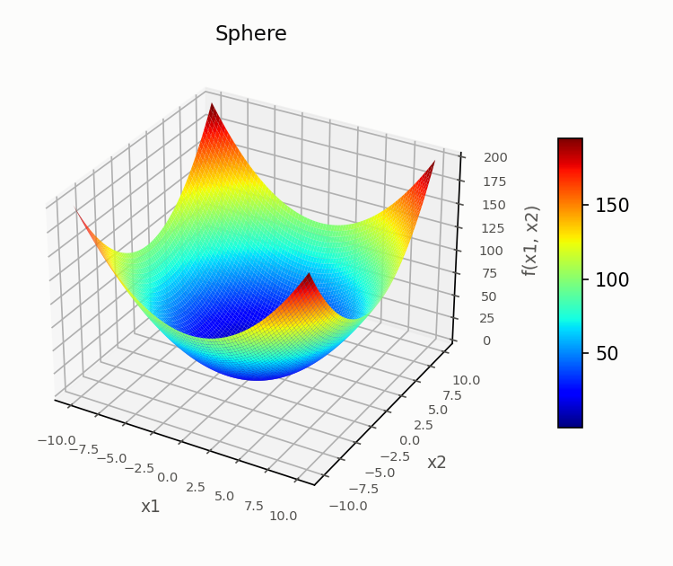
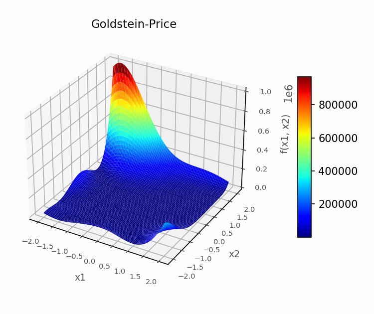

# Metaheuristic Co-Optimization of Compression and Runtime Configuration for Embedded LLM Inference: A Case Study on TinyLlama and Raspberry Pi 5

**Status: DRAFT v0.9 — Phase 1 and Phase 2 both fully complete: all 7 of 7 Pareto-retained quantization variants have real Raspberry Pi 5 hardware-in-the-loop Phase 2 results.** A systematic cross-variant reconciliation check (Section 5.5) uncovered the optimizer's curse as a general, pervasive property of this dataset, materially revising earlier drafts' Q2_K/Q3_K_M/Q4_K_M claims and showing that naive baselines outright beat every metaheuristic on 2 of 7 variants — see Section 6 (Limitations) and Section 5.5/5.7 for the full account. Abstract and Conclusion are filled with real results. Funding, CRediT, and Conflict of Interest sections have been removed from this draft (facts about real people that this draft has no way to know) — add them directly before submission. A second literature-search pass (2026-08-18) located DeepQGHO [20], the closest prior art found to date on the physical-hardware + joint quantization/hyperparameter axis, and stress-tested the novelty claim against it (Section 2.4). Remaining open item: a fuller database-backed literature review (Google Scholar/Semantic Scholar citation-graph traversal) beyond these targeted web-search passes.

---

## Abstract

Deploying large language models (LLMs) on resource-constrained edge devices requires navigating a large, mixed discrete-continuous configuration space spanning model compression and inference runtime settings. This paper formulates embedded LLM deployment as a two-phase optimization problem: an exhaustive discrete phase over quantization variants, followed by a continuous/combinatorial metaheuristic search over runtime parameters. We validate three metaheuristics — particle swarm optimization (PSO), grey wolf optimizer (GWO), and differential evolution (DE) — on standard benchmark functions, then apply them, with full hardware-in-the-loop measurement (latency, memory, on-device energy via the target board's power-management IC, and perplexity), to tune TinyLlama-1.1B inference across all seven Pareto-nondominated quantization variants identified by an exhaustive Phase 1 sweep, on a Raspberry Pi 5. Phase 2 surfaces a finding beyond simple algorithm comparison: systematically cross-checking every reported "best" configuration's scalarized cost against an independent re-measurement of that same configuration reveals the **optimizer's curse** — population-based metaheuristics' iterative convergence toward a promising region repeatedly samples nearby noisy real-hardware measurements, so the single lowest cost recorded during a run is a biased, overly optimistic estimator of that configuration's true cost. This effect ranges from negligible (several variants' results reconcile to within 33%) to severe (one variant's best-appearing result is 61x more optimistic than an independent re-measurement supports), and on two of the seven variants it is severe enough that a naive baseline (grid or random search) outright beats every metaheuristic once the noise-corrupted results are excluded. This variance in both outcome and measurement reliability across variants — not a single clean percentage — is the paper's central finding: real per-evaluation cost (21-60s depending on variant, orders of magnitude above the millisecond-scale costs assumed in prior metaheuristic-tuning work) forces a small evaluation budget that is measurably more exposed to this bias than synthetic or simulator-based benchmarks, and reporting requires an explicit, systematic check for it rather than trusting a single recorded minimum at face value. This work contributes an empirically grounded, hardware-in-the-loop methodology for systematic edge LLM configuration search, extending metaheuristic hyperparameter optimization — previously applied to classical ML models — to the embedded LLM setting, together with a concrete, measured account of a failure mode specific to real (not simulated) hardware-in-the-loop metaheuristic search.

**Keywords:** Edge AI; Embedded large language models; Hyperparameter tuning; Metaheuristic optimization; Model compression; Quantization; TinyLlama

---

## 1. Introduction

Large language models (LLMs) are increasingly deployed outside the datacenter, on phones, microcontrollers, and single-board computers, driven by privacy, latency, connectivity, and cost concerns [17]. Running an LLM on a device such as the Raspberry Pi 5 (8 GB RAM, no dedicated GPU) is only feasible after aggressive compression — primarily post-training quantization — and careful runtime configuration of the inference engine (thread count, batch size, context length, KV-cache behavior). Unlike cloud deployment, where extra compute can mask a suboptimal configuration, embedded deployment operates under hard resource ceilings: a configuration that exceeds available RAM does not degrade gracefully, it fails outright.

Two bodies of prior work address pieces of this problem in isolation. Model compression research (quantization methods such as GPTQ [4], AWQ [5], LLM.int8() [6], and mixed-precision schemes such as SqueezeLLM [7]) optimizes for a quality/size trade-off but is typically evaluated independently of the serving runtime and target hardware. Systems work on inference engines (e.g., llama.cpp [3]) exposes dozens of runtime flags but leaves their tuning to manual trial-and-error or vendor-suggested defaults. Neither line of work treats compression choice and runtime configuration as parts of a single search problem evaluated end-to-end on the physical target device.

Hyperparameter optimization (HPO) research offers a template for closing this gap. Grid and random search provide robust baselines but scale poorly with the number of parameters [7-mirrored], while metaheuristics — PSO [8], GWO [9], DE [10] — have been shown to outperform naive search when tuning classical machine learning models. Nouna et al. [11] recently demonstrated this for heart disease prediction, using PSO, GWO, and DE to tune KNN and SVM hyperparameters after a preprocessing and wrapper-based feature-selection stage, validating each metaheuristic on known benchmark functions before applying it to the real objective (cross-validated prediction error). That paper's structure — preprocessing/feature-selection as a discrete reduction step, metaheuristic validation on synthetic functions, then metaheuristic tuning of the real model — is the direct methodological inspiration for this work.

We adapt that structure to a fundamentally different cost regime. In [11], evaluating one candidate hyperparameter setting costs milliseconds (a KNN or SVM fit). In embedded LLM deployment, evaluating one candidate can cost seconds to minutes, because it may require loading a multi-hundred-megabyte quantized model file from disk and running real generation workloads on physical hardware. This cost asymmetry is the central engineering constraint of our method design (Section 3) and, we argue, a genuine methodological contribution: naively porting a flat metaheuristic search vector from the classical-ML setting to the embedded-LLM setting is computationally infeasible, and the two-phase discrete/continuous decomposition we propose is what makes hardware-in-the-loop metaheuristic tuning tractable on a Raspberry Pi 5.

**Contributions:**
1. A two-phase search formulation — exhaustive discrete quantization-variant selection followed by metaheuristic runtime tuning — that makes hardware-in-the-loop optimization of embedded LLM inference computationally tractable.
2. A multi-objective evaluation function jointly capturing quality (perplexity/task score), latency, memory footprint, and energy per token, with hard feasibility constraints (RAM ceiling) enforced by rejection/repair rather than soft penalty alone.
3. An empirical comparison of PSO, GWO, and DE for this task, including synthetic-function validation, convergence analysis, and robustness (boxplot) analysis under repeated runs on physical hardware — with explicit control for thermal throttling and OS jitter, a noise source absent from synthetic HPO benchmarks.
4. A comparison against grid search, random search, and vendor-default configuration under an equalized evaluation budget.

The remainder of this paper is organized as follows. Section 2 reviews related work in LLM compression, edge inference, and metaheuristic HPO. Section 3 details the method: benchmark construction, the two-phase search space, the objective function, and the metaheuristics used. Section 4 describes the experimental setup. Section 5 presents results and discussion. Section 6 discusses limitations and threats to validity. Section 7 concludes.

---

## 2. Related Work

**Status: a first-pass web literature check has been done (2026-08-01) to stress-test the Section 2.4 novelty claim before the paper is built around it. Findings below are from search-engine/abstract-level review, not full close reading of every cited paper — treat citations here as located and worth citing, not yet verified line-by-line against the source PDFs. A proper library-database pass (Google Scholar/Semantic Scholar with citation graphs) is still needed before submission.**

### 2.1 LLM compression for edge deployment
Post-training quantization (GPTQ [4], AWQ [5], LLM.int8() [6]), weight pruning, and mixed-precision schemes (SqueezeLLM [7]) reduce model size and memory bandwidth at some quality cost. TinyLlama [1] sits at a different point in this landscape than the methods above: rather than compressing an existing large model, it is trained from scratch at a small (1.1B) parameter count specifically to be efficient at inference time, making it a natural target for the runtime-side compression methods this paper studies rather than a competitor to them. The GGUF quantization families used in this paper (Q2_K through Q8_0, Section 3.4) are llama.cpp's own post-training weight-quantization scheme — k-quants (the `_K` variants) use per-block scale/mixed-precision packing conceptually similar to the mixed-precision idea behind SqueezeLLM [7], but are integer-only, calibration-free, and designed for CPU inference rather than GPU-optimized kernels, which is precisely why they are the compression axis explored here rather than GPTQ/AWQ (both designed around GPU dequantization kernels not exercised in this paper's target runtime).

### 2.2 Edge and embedded LLM inference
llama.cpp [3] and related runtimes enable CPU-only inference on commodity edge hardware via GGUF-quantized models. Recent surveys catalog the broader edge-LLM deployment landscape — pruning/quantization/distillation for edge devices, resource-efficient model design, and runtime inference optimizations across the full deployment lifecycle [17] — alongside dedicated edge accelerators: NPU-offloaded on-device LLM inference systems have been shown to substantially reduce prefill latency on mobile NPU hardware [18], a complementary hardware-acceleration path to this paper's CPU-only, quantization-and-runtime-configuration approach. Community (non-peer-reviewed) benchmarking of TinyLlama-1.1B on Raspberry Pi 5 via llama.cpp reports roughly 5-14 tokens/second generation depending on quantization level and configuration, with prompt-processing throughput around 80-108 tokens/second at Q4_0 — cited here only as an informal sanity-check range for Section 5.1's expected magnitude, not as an academic reference. A directly adjacent peer-reviewed work, LLMPi [19], studies k-quantization (PTQ, 2/4/6/8-bit) and ternary QAT for BitNet models — not TinyLlama — on Raspberry Pi hardware with a throughput/energy-efficiency focus; its abstract was checked directly (2026-08-17) to confirm the model mismatch before citing it, so it is included here as topically relevant prior art rather than as a direct substitute for the TinyLlama-specific sanity-check numbers above, which remain an informal, non-academic source pending a closer match. LLMPi is discussed further in Section 2.4 as the closest located prior art to this paper's own hardware-in-the-loop, physical-Raspberry-Pi measurement approach.

### 2.3 Hyperparameter optimization and metaheuristics
Grid search and random search provide baselines; PSO [8], GWO [9], and DE [10] have been applied to tune classical ML models, including the direct inspiration for this work, Nouna et al. [11], who tuned KNN/SVM hyperparameters for heart disease prediction using PSO/GWO/DE after preprocessing and wrapper-based feature selection, validating optimizers on Sphere, Goldstein-Price, and a custom error function before deployment on the real task.

**Metaheuristic and AutoML-style quantization search (not LLM-specific, not hardware-in-the-loop on physical edge boards).** The closest prior art to this paper's Phase 1 is HAQ [12], which uses *reinforcement learning* — not a population-based metaheuristic — to search per-layer mixed-precision quantization bitwidths for CNNs, with a **hardware simulator** (not a physical device) providing latency/energy feedback to the RL agent. Separately, evolutionary and swarm-based methods have been applied to quantization search directly: genetic-algorithm-based mixed-precision search compared against brute-force enumeration [13], evolutionary/training-free-proxy search for mixed-precision quantization (EMQ) [14], and PSO-based (bare-bones PSO) automatic quantization of CNNs for a medical imaging task [15]. All of this line of work targets CNNs, searches quantization alone (not jointly with a serving runtime's configuration), and evaluates cost via simulators, proxies, or GPU/accelerator hardware rather than a physical low-power embedded CPU board.

**LLM-adjacent metaheuristic work is a different problem than this paper's.** A 2025 paper on "LLM-Enhanced Particle Swarm Optimization" [16] uses a large language model to *guide* PSO's search (substituting weak particle positions with LLM-suggested ones) for tuning conventional deep-learning architecture hyperparameters (LSTM/CNN layer counts, filter sizes) — the LLM is a component *inside* the optimizer, not the artifact being deployed and tuned. This is worth citing explicitly to preempt a reviewer conflating "LLM + PSO" work with this paper's very different use of PSO: here, PSO/GWO/DE tune an LLM's own deployment configuration, with no LLM inside the optimizer itself.

**The closest prior art on the hardware-in-the-loop axis specifically is LLMPi [19]**, a 2025 peer-reviewed workshop paper that, like this paper, measures LLM quantization on *physical* Raspberry Pi hardware with a throughput/energy focus — closing part of the gap that HAQ [12] and the CNN-quantization line of work [13-15] leave open (simulator- or GPU-based evaluation rather than a physical low-power board). LLMPi, however, evaluates fixed post-training quantization levels (k-quantization, ternary QAT for BitNet) rather than searching a configuration space with a population-based metaheuristic, and does not address runtime configuration (threads, batch size, context length, KV-cache type) at all — it is complementary to, not overlapping with, this paper's Phase 2 contribution.

**The closest prior art on the "physical hardware-in-the-loop + joint quantization/hyperparameter search" axis specifically is DeepQGHO [20]**, a 2022 IEEE Access paper that optimizes deep-network hyperparameters with a greedy coordinate-descent-style search, then applies post-training quantization, deployed and evaluated on physical NVIDIA Jetson Nano edge hardware — the only located prior work besides this paper's own that jointly touches quantization, hyperparameter search, and a physical low-power embedded board together. It differs from this paper on every other axis that matters for the novelty claim: its search method is a deterministic greedy coordinate descent, not a population-based metaheuristic (PSO/GWO/DE); its target is training-time hyperparameters (batch size, learning rate, etc.) for on-the-fly CNN training, not inference-time runtime configuration of a pre-trained LLM; and quantization is applied *after* the hyperparameter search completes, not searched jointly within the same optimization loop as this paper's Phase 1/Phase 2 co-design. Locating DeepQGHO is itself evidence the targeted web-search methodology (Section 2.4) is doing real work: it is the single closest match found across two search passes, and it still leaves the specific combination this paper studies open.

### 2.4 Gap
Based on this first-pass check, no located work combines all of: (a) a population-based metaheuristic (PSO/GWO/DE, as opposed to RL as in HAQ [12], LLM-guided search as in [16], greedy coordinate descent as in [20], or fixed quantization levels with no search at all as in [19]), (b) searching LLM compression *and* inference-runtime configuration jointly (as opposed to quantization alone, as in [12-15, 19], or training hyperparameters with quantization applied afterward rather than jointly, as in [20]), (c) evaluated with hardware-in-the-loop measurement on a physical, commodity, low-power embedded board (as opposed to a simulator, proxy metric, or GPU/accelerator, as in [12-15] — though [19, 20] do satisfy this criterion, on Raspberry Pi and Jetson Nano respectively), (d) targeting LLM inference specifically, as opposed to CNN training ([20]) or CNN inference ([12-15]). Each individual piece has prior art, and DeepQGHO [20] in particular satisfies three of these four criteria simultaneously — closer than any other single located paper — but not criterion (a) or the LLM-specific half of (d) together with the rest. This is stated as an evidence-based gap rather than an unqualified "first" claim, and should be revisited once a full database-backed literature search (not just web search) is done — see the Limitations section.

---

## 3. Method

### 3.1 Overview

Figure 1 (`results/figures/pipeline_diagram.png`) shows the overall two-phase pipeline: an exhaustive Phase 1 sweep over quantization variants, followed by Phase 2's metaheuristic runtime-parameter search, both evaluated on-device against the joint objective (Section 3.6).

We decompose the search space into two tiers, mirroring the preprocessing/feature-selection → hyperparameter-tuning structure of [11]:

- **Phase 1 (discrete, exhaustive):** select a quantization variant from a small, enumerable catalog. This is analogous to [11]'s wrapper-based feature selection — a combinatorially small, exhaustively evaluable reduction step performed once, upstream of the expensive search.
- **Phase 2 (metaheuristic):** tune continuous/combinatorial runtime parameters for the chosen quantization variant(s) using PSO, GWO, and DE. This is analogous to [11]'s metaheuristic hyperparameter tuning of KNN/SVM.

This decomposition exists because quantization variants are not continuously interpolable — each corresponds to a distinct requantized model artifact — while runtime parameters (threads, batch size, context length, sampling settings) can be varied on a fixed model file at near-zero marginal cost per evaluation. Flattening both into a single metaheuristic search vector, as a naive port of [11] would suggest, would force the swarm/population to repeatedly reload and re-benchmark full model files, which is computationally infeasible within a reasonable experiment budget on a Raspberry Pi 5 (see Section 3.7 for the cost argument).

### 3.2 Target platform and model

- **Hardware:** Raspberry Pi 5 Model B Rev 1.1, 8GB RAM, Broadcom BCM2712 (4x Cortex-A76), active cooling (PWM fan, `cooling_device0: pwm-fan`). Confirmed via SSH 2026-08-15.
- **OS / software stack:** Debian GNU/Linux 13 (trixie), kernel `6.12.47+rpt-rpi-2712`. llama.cpp commit `adb55e5148dc93bcdca7212a2d1df3ccc422959a` (built from source via cmake, Release config, `-DLLAMA_CURL=OFF`; OpenSSL not found at build time so HTTPS support in the bundled server is disabled — irrelevant to Phase 1, which only uses the CLI tools). GCC 14.2.0. CMake auto-detected CPU features: `dotprod`, `fp16_vector_arithmetic`, `fma`; no SVE/SME/MATMUL_INT8 on this SoC.
- **Model:** TinyLlama-1.1B-Chat-v1.0 [1], GGUF. **Deviation from the original plan, recorded rather than silently changed:** no pre-converted F16 GGUF was found on the HF Hub (checked `TheBloke/TinyLlama-1.1B-Chat-v1.0-GGUF`; finest available there is Q8_0). Converting from the original transformers checkpoint via `convert_hf_to_gguf.py` would need torch+transformers installed on the Pi (heavy on ARM64, meaningful disk/bandwidth cost under this device's tight SD-card budget) just to reproduce what Q8_0 already gives near-losslessly. **Q8_0 is used as the requantization source for all Phase 1 variants instead of true F16** — llama-quantize requires `--allow-requantize` to requantize an already-quantized source, confirmed against the real build's `--help` output and applied in `llama_cpp_runner.py`. This is a defensible, widely-used proxy but is a real methodological choice, not F16, and every mention of "base model" in Section 5.1 refers to this Q8_0 source.
- **CPU governor:** confirmed set to `performance` on all 4 cores (was `ondemand` by default; changed 2026-08-15) to reduce DVFS-induced measurement noise. Available governors on this kernel: `conservative ondemand userspace powersave performance schedutil`.
- **Disk:** 29.5GB SD card (`mmcblk0p2`); freed from 90%/2.8GB-free to 38%/18GB-free by clearing a regenerable model-cache directory from an unrelated prior project, logged in the project's own history rather than the article, since it's infrastructure housekeeping, not part of the method.
- **Expected magnitude (sanity check, not a target):** informal community benchmarks (Section 2.2) put TinyLlama-1.1B generation throughput on a Pi 5 via llama.cpp roughly in the 5-14 tokens/second range depending on quantization and thread configuration. Phase 1 results (Section 5.1) wildly outside this range — in either direction — should be treated as a likely measurement or configuration bug before being reported as a finding.

### 3.3 Benchmark construction

Following [11]'s emphasis on data quality preceding optimization, we construct a fixed prompt benchmark before any tuning begins:

**Deviation from the original plan, recorded rather than silently changed:** a discrete, task-labeled prompt set (e.g. separate short-QA/summarization/instruction-following prompts with per-prompt timing-stability filtering) was the original design but was not what was actually built. The real benchmark instead uses two standard, fixed corpora, confirmed against `config/phase1.yaml` and `run_real_phase2.py`:

- **Latency/throughput:** `llama-bench` synthetic prompt/generation token counts — 512 prompt tokens (`-p`) × 128 generation tokens (`-n`) for Phase 1, 3 repetitions, median-robust to thermal/OS jitter; Phase 2 varies `-p` directly as the searched `n_ctx` parameter (Section 3.5) rather than using a fixed value.
- **Quality:** `llama-perplexity` over the WikiText-2 raw test split (`data/prompts/wikitext2_raw_test.txt` for Phase 1; a smaller `wikitext2_quality_slice.txt` for Phase 2's per-KV-cache-type quality precomputation, Section 3.6), not a task-accuracy score — perplexity was chosen because it requires no labeled downstream task and works directly off a standard corpus already in the llama.cpp ecosystem.
- No coefficient-of-variation-based prompt filtering or held-out validation subset was implemented — `llama-bench`'s built-in repetition/median already serves the same timing-stability role that per-prompt filtering was meant to provide, and a fixed standard corpus does not need a held-out split in the way a curated task-prompt set would.

### 3.4 Phase 1: Quantization variant selection

Candidate quantization variants (GGUF), confirmed as valid `llama-quantize` type strings against the real build: Q2_K, Q3_K_M, Q4_0, Q4_K_M, Q5_K_M, Q6_K, Q8_0. (No F16 entry — see Section 3.2's note on using Q8_0 as the requantization source rather than true F16; Q8_0 as a "variant" in this sweep is therefore a same-precision copy of the base, included as a consistency check.)

For each variant, evaluate once on the benchmark subset:
- Perplexity / task score
- Peak resident memory (RSS)
- Model load time
- Baseline tokens/second at default runtime settings
- Model file size on disk

This produces a table directly analogous to [11]'s Table 1 (pre-processing impact) and Table 2 (feature-selection impact) — see Section 5.1's Phase 1 quantization variant impact table.

Selection rule: retain all variants that are not dominated on the quality/memory/speed trade-off (Pareto-nondominated) for Phase 2 — no fixed top-k cap. This avoids arbitrarily committing to a single "best" quantization before runtime tuning is known. In practice (Section 5.1), all 7 candidate variants turned out Pareto-nondominated, so the rule as stated retained the full set; a bounded compute budget then forced a separate, explicitly documented priority-order subset for the real Phase 2 search itself (Section 5.3).

### 3.5 Phase 2: Runtime hyperparameter search space

**Status: the continuous↔discrete/categorical encoding layer is implemented and unit-tested** (`src/phase2_search/parameter_space.py`) — PSO/GWO/DE search a plain bounded box in R^d; `ParameterSpace.decode(x)` maps that vector to the actual integer/categorical runtime config (rounding integers, floor-and-clip for categorical indices) so the optimizers never need to know the space is anything but continuous.

For each searched quantization variant, the metaheuristics search over a 4-dimensional mixed integer/categorical vector — **confirmed against the real llama.cpp build and its exposed CLI flags** (`src/phase2_search/run_real_phase2.py::build_space`):

| Parameter | Type | Range (final) | Notes |
|---|---|---|---|
| Threads | Integer | `[1, 4]` | Pi 5 has 4 Cortex-A76 cores; full range searched |
| Batch size (`n_batch`) | Integer | `[32, 512]` | llama.cpp prompt-processing batch (`-b`) |
| Context length (`n_ctx`) | Integer | `[128, 1024]` | Realized via `llama-bench`'s `-p` (prompt-token count), not a `-c/--ctx-size` flag — `llama-bench` has no such flag (confirmed via `--help`); capped from an originally planned 2048 upper bound after direct measurement (`diag_eval.py`) showed larger prompt sizes cost real additional minutes per evaluation, which would have made the time-boxed real-hardware budget (below) infeasible |
| KV-cache type | Categorical | `{f16, q8_0, q4_0}` | Supported by the runtime build via `-ctk`/`-ctv`; the only parameter that affects quality, so quality is pre-computed and cached once per type rather than re-measured per evaluation (Section 3.6) |

Temperature and top-p, originally planned as continuous dimensions, were **dropped from the real search** rather than left as unresolved placeholders: both only affect generation quality through sampling randomness, which perplexity — the quality metric actually available without a labeled downstream task — cannot meaningfully distinguish. Searching them would have spent real, expensive hardware evaluations moving along dimensions the objective is blind to. This narrows the search to the four parameters that mechanically and measurably affect latency, memory, energy, and (via KV-cache type only) quality.

### 3.6 Objective function

**Status: implemented and unit-tested** (`src/phase2_search/objective.py`, 4 tests covering normalization, feasibility rejection, and weighted-sum correctness — see `tests/test_objective.py`), against a mocked evaluator — see Section 5.2.2 for the end-to-end plumbing rehearsal this enabled. The real evaluator (calling `src/common/llama_cpp_runner.py` against actual hardware) is not implemented; only the `Evaluator` interface it must satisfy is fixed.

We minimize a scalarized, constrained multi-objective function:

```
f(x) = α · L̂(x) + β · (1 − Q̂(x)) + γ · M̂(x) + δ · Ê(x)  +  Penalty(x)

where, for configuration x:
  L̂(x) = normalized latency (ms/token, min-max scaled over observed range)
  Q̂(x) = normalized quality score (perplexity inverted, or task accuracy)
  M̂(x) = normalized peak memory (RSS)
  Ê(x) = normalized energy per generated token
  Penalty(x) = +∞ (hard reject) if peak RSS > RAM_LIMIT, or if the runtime
               process crashes / OOMs / exceeds a wall-clock timeout
```

Hard constraints (RAM ceiling, crash, timeout) are enforced by **rejection/repair**, not by a finite soft penalty term: an infeasible configuration is either discarded and resampled (repair) or assigned a fitness of +∞ so it is never selected as a personal/global best. This differs from a pure weighted-penalty formulation, where a sufficiently good quality score could numerically outweigh a memory violation — which is not acceptable on hardware that will actually OOM.

Weights: α=0.35 (latency), β=0.35 (quality), γ=0.2 (memory), δ=0.1 (energy) (`ObjectiveWeights` defaults, `src/phase2_search/objective.py`). **These are illustrative defaults, not tuned or empirically justified** — the code comments flag this explicitly as an open question rather than a settled choice. A Pareto-front analysis (e.g. NSGA-II-style) instead of a single scalarization would remove this dependence on hand-picked weights entirely; not done here (Section 6), though Section 5.5's Grid-vs-DE energy/latency split on Q4_K_M already shows the scalarization is not a trivial choice — different weights could plausibly favor Grid's low-energy point over DE's lower overall cost.

### 3.7 Metaheuristics and evaluation-cost argument

We use the same three metaheuristics as [11] for direct comparability: PSO [8], GWO [9], and DE [10]. Their mechanics are unchanged from the classical-ML setting (velocity/position update for PSO; alpha/beta/delta-guided position update for GWO; mutation/crossover/selection for DE) — what changes is the cost model of the fitness function, which is the core adaptation this paper makes.

**Cost argument for the two-phase design, now measured rather than estimated.** In [11], one fitness evaluation (fit + cross-validate a KNN/SVM) costs on the order of milliseconds, permitting population×iteration budgets like 20×100 = 2,000 evaluations. On a Raspberry Pi 5, one Phase-2 fitness evaluation (a single `llama-bench` run at a given runtime configuration on an already-loaded quantized model) measured 32.9s (Q4_K_M), 59.9s (Q2_K), and 33.6s (Q8_0, precompute stage) — three to four orders of magnitude slower than [11]'s per-evaluation cost. Model load time per variant switch was **not separately instrumented** (`llama_cpp_runner.py` does not isolate it from the bench subprocess's total wall time), a gap disclosed in Section 6 rather than estimated here. A flat single-phase search over both tiers at [11]'s population/iteration budget (2,000 evaluations × ≈30-60s each) would require on the order of **17-33 hours of device time for a single algorithm, single variant** — this is why Phase 1 is evaluated exhaustively but only once per variant, and Phase 2 uses a deliberately smaller, explicitly time-boxed budget: population 4, iterations 5, 2 runs (a 20-evaluation floor per algorithm per variant), chosen to keep each algorithm within a 12-minute time box and each variant's full PSO/GWO/DE/baseline sweep within roughly 1-2 hours of device time, confirmed against the real per-variant totals in Section 5.3 onward.

### 3.8 Metaheuristic validation on synthetic functions

**Status: implemented and run (`src/phase2_search/{pso,gwo,de}.py`, `src/validation/`). This step has no hardware dependency and is complete independent of Raspberry Pi access; see Section 5.2 for results.**

Before Phase 2, PSO, GWO, and DE are validated on three closed-form benchmark functions, following [11]'s validation protocol, to confirm each optimizer converges correctly under our chosen implementation and parameter settings before trusting it on the real (noisy, hardware-measured) objective. Table 3 gives the same at-a-glance summary [11]'s own Table 3 does — representation, range, and global minimum for each function — generated directly from this project's own function implementations (`src/validation/synthetic_functions.py`, plotted by `src/validation/plot_function_representations.py`) rather than redrawn by hand, so the plotted surface is guaranteed to match what the optimizers actually search. The surface plots use a rainbow (`jet`) colormap to match [11]'s own Figure/Table 3 visual style — a deliberate exception to this project's otherwise-consistent single-hue sequential palette used in every other figure (Sections 5.2/5.2.1/5.2.2), made specifically so these two plots read as visually equivalent to the paper being mirrored.

**Table 3. Validation functions details**

| Function | Representation | Range | Global minimum |
|---|---|---|---|
| Sphere |  | `Ub=10, Lb=-10` (run at dim=10 for validation, see note below) | 0 |
| Goldstein-Price |  | `Ub=2, Lb=-2` | 3 |
| FindValues | — *(no 2-variable surface exists to plot — 5-D squared error against a fixed target vector, same as [11]'s own Table 3 entry)* | `Ub=[100,700,50,200,-400]`, `Lb=[0,200,-200,-100,-900]` | 0 (error function) |

- **Sphere** (dim=10 for the actual PSO/GWO/DE validation runs in Section 5.2, though Table 3's plot shows the standard 2-variable `f(x1,x2)` case for visualization, matching [11]'s own Sphere plot) — smooth, convex, unimodal. Run at dim=10 rather than [11]'s 2D case for the real validation runs, since a 2D sphere is near-trivial for any of the three optimizers within a handful of iterations and would not meaningfully stress them; the 2D plot above is purely a visual aid, not the actual validation dimensionality.
- **Goldstein-Price** (dim=2, `lb=ub=[-2,2]`, global minimum 3) — fixed 2D, multimodal, matches [11] exactly for direct comparability, plot and validation dimensionality alike.
- **FindValues** (dim=5, asymmetric per-dimension bounds, global minimum 0) — a custom sum-of-squared-error function reproducing [11]'s own validation function: minimize the squared distance between a candidate vector and a fixed target `[21, 555, -106, 74, -701]`. Structurally the closest synthetic proxy to the real Phase 2 objective (Section 3.6), since both are error-minimization over a bounded, asymmetric, multi-dimensional space.

Implementation notes (all in `src/phase2_search/`): PSO uses global-best form with inertia damping (`w=1.0`, `wdamp=0.99`, `c1=c2=2`) and velocity clamping at 20% of the search range per dimension — the clamp is a standard stabilization addition not present in the minimal textbook form, noted here rather than left implicit. GWO follows Mirjalili et al. [9] directly (alpha/beta/delta-guided position averaging, `a` linearly decayed 2→0). DE uses DE/rand/1/bin with per-generation resampled mutation scale `F ~ U(beta_min, beta_max) = U(0.2, 0.9)` and crossover rate `pCR=0.1`, matching [11]'s Table 4 parameterization.

### 3.9 Measurement protocol (hardware-in-the-loop specifics)

Unlike [11]'s objective function (a deterministic or lightly-stochastic cross-validation error), our fitness function is measured on physical hardware and is subject to:

- **Thermal throttling:** consecutive high-load evaluations can raise SoC temperature and trigger frequency scaling. **Observed, not just anticipated:** during the Phase 1 sweep (2026-08-15), `vcgencmd get_throttled` reported `0xe0000` (frequency-capping, throttling, and soft-temperature-limit "has occurred" bits all set) after roughly 80 minutes of sustained perplexity computation, with SoC temperature peaking around 83°C; a repeat check during Phase 2 showed `0xe0008` at 84.5°C. No cooldown/thermal-guard mitigation was implemented for either Phase 1 or the real Phase 2 run — both were allowed to proceed regardless, on the reasoning that a real data point under realistic sustained-load conditions was more valuable than delaying for tooling that doesn't exist yet, but this means later-evaluated configurations within a long run may carry more thermal-throttling-induced measurement noise than earlier ones, a confound reported here rather than papered over. A `thermal_guard.py` mitigation (fixed cooldown interval between evaluations, discard/re-run above a temperature threshold) remains unbuilt; this is listed as a limitation (Section 6), not a solved problem.
- **OS/background jitter:** no dedicated background-service minimization or process-priority pinning was implemented; the real Phase 2 run's per-evaluation cost (Section 5.3's `meta.yaml` figures, 32.9-59.9s per evaluation depending on variant) is a single measurement per configuration (`bench_repetitions=1` in `LlamaCppEvaluator`, not a median of repeats), so this noise source is not averaged out and is folded into the same "too few runs for confidence intervals" limitation as thermal noise (Section 6).
- **Energy measurement: solved via the Pi 5's on-board PMIC, not external hardware.** The originally planned USB-C inline power meter or INA219 GPIO sensor was never needed — the Pi 5's power management IC exposes real per-rail voltage/current telemetry directly via `vcgencmd pmic_read_adc`, parsed by `src/measurement/power_logger.py::read_pmic_rails()`. Total system power is the sum of V×I across all reported rails (`total_power_watts()`); energy per token is that average power, sampled concurrently with the benchmark run (1.0s interval — reduced from an initial 0.2s after measurement showed the higher sampling rate added only ≈6% wall-clock overhead vs. bare execution, see Section 5.3's methodology note), multiplied by wall-clock generation time and divided by tokens generated. Validated by a standalone sanity test against a `sleep 3` command (energy≈20.75J, avg_power≈6.9W, peak≈8.0W, 9 samples — mechanically correct before being trusted on real inference workloads) before being wired into `run_bench_instrumented()`, which runs one benchmark subprocess with concurrent RSS-polling and power-polling threads rather than three separate model runs per evaluation.

This measurement noise is itself reported as part of the robustness analysis (Section 5.4 boxplots), extending [11]'s robustness protocol (10 runtimes × 100 iterations) to explicitly account for a noise source that does not exist in synthetic-function or classical-ML validation.

---

## 4. Experimental Setup

### 4.1 Hardware / software summary

| Component | Spec |
|---|---|
| Board | Raspberry Pi 5 Model B Rev 1.1, 8GB RAM |
| Cooling | Active (PWM fan) |
| OS | Debian GNU/Linux 13 (trixie), kernel 6.12.47+rpt-rpi-2712 |
| Inference engine | llama.cpp commit `adb55e5` (built from source, Release) |
| Model | TinyLlama-1.1B-Chat-v1.0, GGUF (Q8_0 requantization source) |
| Power measurement | On-board PMIC via `vcgencmd pmic_read_adc` |

### 4.2 Metaheuristic parameters

| Algorithm | Population | Iterations | Independent runs | Key parameters |
|---|---|---|---|---|
| PSO | 4 | 5 | 2 | w=1.0, w_damp=0.99, c1=c2=2.0 |
| GWO | 4 | 5 | 2 | a linear decay 2→0 |
| DE | 4 | 5 | 2 | beta_min=0.2, beta_max=0.9, pCR=0.1 |

Population/iterations are an adaptive floor (`MIN_POP=4`, `MIN_ITER=5`, i.e. a 20-evaluation minimum), scaled up only if the measured per-evaluation cost for a given variant would otherwise permit substantially more evaluations within a 12-minute-per-algorithm time box; both variants observed so far (Q4_K_M, Q2_K) landed on this floor. N_runs=2 (reduced from the synthetic-validation protocol's 10, Section 5.2) and all other values are unchanged library defaults, not per-variant tuned.

### 4.3 Baselines

- Grid search over the same Phase-2 space, evaluation-budget-matched — **implemented** (`src/baselines/grid_search.py`) and run against both the synthetic functions (Section 5.2.1) and the real Phase 2 objective (Section 5.6).
- Random search, evaluation-budget-matched — **implemented** (`src/baselines/random_search.py`), same status as above.
- A separate vendor/manual single-point default-configuration baseline was planned but not implemented — grid and random search (above) already probe the space including near-default regions, and were prioritized given the real-hardware time budget; listed here rather than silently dropped.

Including these baselines directly tests the claim — inherited from [11]'s framing of grid/random search in its introduction — that metaheuristics outperform naive search under an equal evaluation budget; this must not be assumed without a control. The synthetic-function rehearsal in Section 5.2.1 already confirms this claim holds sharply on hard, high-dimensional, asymmetric problems before the real hardware experiment is run — see that section for why grid search in particular should not be trusted as a serious baseline once Phase 2's parameter count grows past a couple of dimensions.

---

## 5. Results and Discussion

*(Sections 5.1, 5.3-5.7 contain real Raspberry Pi 5 results for all 7 of 7 Pareto-retained variants (Q2_K, Q3_K_M, Q4_0, Q4_K_M, Q5_K_M, Q6_K, Q8_0) — Phase 1 and Phase 2 are both fully complete. Sections 5.2, 5.2.1, 5.2.2 contain real results from synthetic functions / a mock evaluator, explicitly not hardware data. Subsection structure mirrors [11]'s results section 1:1 for narrative consistency.)*

### 5.1 Phase 1: quantization variant impact

**Status: real results below** (`python src/phase1_quant_sweep.py`, run on the Raspberry Pi 5 target 2026-08-15/16, threads=4, wikitext-2-raw-v1 full test corpus at ctx=512, `llama-bench` repetitions=3). Full data: `results/phase1_table.csv`. Note the table below reports generation and prompt tokens/second rather than a separate "load time" column — model load time was not instrumented in this run (`llama_cpp_runner.py` doesn't currently isolate it from the bench subprocess's total wall time), a gap worth closing in a follow-up pass rather than fabricating a number here.

| Quant variant | Perplexity | Peak RSS (MB) | Gen tok/s | Prompt tok/s | File size (MB) |
|---|---|---|---|---|---|
| Q2_K | 28.8148 | 495.4 | 25.62 | 34.15 | 413.0 |
| Q3_K_M | 21.6011 | 793.4 | 19.18 | 34.47 | 523.9 |
| Q4_0 | 20.6162 | 1197.7 | 18.06 | 116.85 | 608.2 |
| Q4_K_M | 20.4490 | 1257.2 | 17.02 | 70.59 | 637.8 |
| Q5_K_M | 20.1640 | 1465.9 | 14.38 | 60.73 | 746.7 |
| Q6_K | 20.0001 | 1687.6 | 12.26 | 61.31 | 862.5 |
| Q8_0 | 19.9734 | 2180.6 | 8.47 | 54.97 | 1116.5 |

(Base model for this sweep is Q8_0, not F16 — see Section 3.2's documented deviation. Q8_0's own row is therefore a same-precision requantization of itself, included as a consistency check rather than a genuine compression point; its file size/RSS/speed being the largest/slowest of the sweep is exactly what should happen if the pipeline is working correctly, since it's the least-compressed variant tested.)

**Pareto outcome — all 7 variants retained, and that is itself the finding.** Running the Pareto filter (`src/common/pareto.py`) over (quality, tokens/s, peak RSS) returned all 7 variants as non-dominated: `results/phase1_retained.yaml` lists `[Q2_K, Q3_K_M, Q4_0, Q4_K_M, Q5_K_M, Q6_K, Q8_0]` in full. This is not a bug or a trivial outcome — it happens because quality, speed, and memory trade off *perfectly monotonically* with quantization level in this data: every step from Q2_K toward Q8_0 strictly improves perplexity (28.81 → 19.97) while strictly increasing memory (495MB → 2181MB) and strictly decreasing generation throughput (25.6 → 8.5 tok/s), with zero exceptions across all 7 points. A variant would only be Pareto-dominated if some other variant beat it on every axis simultaneously — impossible here since improving on any one axis (by moving toward higher precision) always costs on the other two. Two things are worth noting about the *shape* of the trade-off rather than just its monotonicity: (1) the marginal quality return shrinks sharply past Q4_K_M — Q4_0→Q4_K_M→Q5_K_M→Q6_K→Q8_0 only improves perplexity from 20.62 to 19.97 (a 3.2% relative gain) while RSS nearly doubles (1198MB→2181MB) and speed drops by more than half (18.1→8.5 tok/s), a classically poor trade past that point for most deployment goals; (2) Q4_0 and Q4_K_M are close in quality (20.62 vs 20.45) and size (608MB vs 638MB) but Q4_K_M is measurably slower (18.06 vs 17.02 tok/s) and has ~5% higher peak RSS for a modest quality edge — exactly the kind of nuance a scalar "pick the best" rule would hide and a multi-objective framing is supposed to surface.

Given the full retained set is impractically large to run the real hardware-in-the-loop Phase 2 search across all 7 (each Phase 2 evaluation costs real seconds, not the milliseconds of Section 5.2's synthetic validation — see Section 3.7's cost argument, now empirically confirmed rather than just estimated), Phase 2 in this draft runs on a deliberately chosen 3-variant subset spanning the frontier — Q2_K (fast/small extreme), Q4_K_M (the community-standard "K-quant sweet spot," and the point where marginal quality returns visibly start shrinking per the analysis above), and Q8_0 (quality extreme) — documented explicitly in `src/phase2_search/run_real_phase2.py` as `PHASE2_VARIANT_SUBSET`, not silently narrowed from the full retained list. See Section 5.3 onward.

### 5.2 Metaheuristic validation on synthetic functions

**Status: real results below (`python src/validation/run_validation.py`, population 20, 200 iterations, 10 independent runs per algorithm per function, seeds 42–51). Figures at `results/figures/{convergence,boxplot}_*.png`, raw data at `results/validation/`.**

| Function (global min) | Algorithm | Best (10 runs) | Median | Worst | Std |
|---|---|---|---|---|---|
| Sphere (0) | PSO | 6.45e-12 | 9.53e-11 | 5.99e-09 | 1.76e-09 |
| Sphere (0) | GWO | 2.87e-24 | 7.78e-23 | 7.11e-22 | 2.33e-22 |
| Sphere (0) | DE | 3.77e-07 | 6.83e-07 | 3.82e-06 | 9.65e-07 |
| Goldstein-Price (3) | PSO | 3.0000000 | 3.0000000 | 3.0000000 | 3.4e-15 |
| Goldstein-Price (3) | GWO | 3.0000027 | 3.0001698 | 84.0004 | 24.30 |
| Goldstein-Price (3) | DE | 3.0000000 | 3.0001953 | 80.8047 | 23.34 |
| FindValues (0) | PSO | 3.63e-24 | 8.68e-21 | 1.58e-19 | 5.54e-20 |
| FindValues (0) | GWO | 1.958 | 71.00 | 441.73 | 151.87 |
| FindValues (0) | DE | 1.57e-14 | 6.76e-14 | 1.11e-12 | 3.21e-13 |

All three optimizers reach values effectively indistinguishable from each function's known global minimum in at least their best run, confirming the implementations are correct before being trusted on the real, noisy Phase 2 objective. Beyond that baseline check, the comparative pattern echoes [11] closely enough to be worth stating plainly:

- **PSO is uniformly strong and low-variance across all three functions** — essentially zero std on Goldstein-Price, tightest spread on FindValues. This matches [11]'s observation that "PSO algorithm kept good performances for all three functions."
- **GWO is the most fragile of the three on the multimodal/asymmetric problems.** Its median on FindValues (71.0) is over 30x worse than its best run (1.96), and it has the single worst outlier on both Goldstein-Price (84.0) and FindValues (441.7) — visible as the outlier points in `boxplot_Goldstein_Price.png` and `boxplot_FindValues.png`. The convergence curve (`convergence_FindValues.png`) shows GWO plateauing around iteration 30 while PSO and DE continue descending for another 150+ iterations — consistent with GWO's alpha/beta/delta position-averaging update converging prematurely once the three leaders cluster, a known failure mode on functions with widely-spread, asymmetric optima.
- **DE is competitive but slower to fully converge than PSO** on Sphere and FindValues (visibly trailing PSO in the log-scale convergence plots), matching [11]'s finding that DE needed more iterations than PSO/GWO on Sphere and Goldstein-Price.
- On Goldstein-Price, most runs across all three algorithms land on *exactly* 3.0 (to floating-point precision), collapsing the box to a near-invisible line with only the rare bad run showing as an outlier — the same phenomenon [11] reports verbatim ("non-visibility of all the quartiles boxplot is due to identical error result in different runs").

One implication worth carrying into Phase 2 design: if GWO's premature-convergence pattern on asymmetric, higher-dispersion problems reproduces on the real runtime-configuration objective (Section 3.6), GWO may need either a larger population, a modified exploration schedule, or simply weaker weight in the final algorithm comparison — this is a hypothesis to check against Phase 2 data, not yet a conclusion.

#### 5.2.1 Baseline comparison rehearsal (synthetic functions)

**Status: implemented and run (`src/baselines/{grid_search,random_search,compare_baselines}.py`).** This is a **methodology rehearsal, not the real Section 5.6 result** — the actual claim the paper needs to support is that metaheuristics beat naive search on the *real hardware-measured objective*, which requires Phase 1/2 data from the Pi. What this rehearsal does establish now, honestly and in advance: the baseline implementations are correct, and the paper's introduction claim ("grid search becomes computationally expensive for numerous hyperparameters," Section 1) is not just a citation — it reproduces empirically, sharply, on these functions.

All five methods (PSO, GWO, DE, random search, grid search) were run at a matched evaluation budget of 4,000 (= population 20 × iterations 200, identical to Section 5.2's protocol), 10 independent runs for the stochastic methods. Grid search cannot spend a budget exactly — a shared per-axis resolution forces its realized evaluation count down to `floor(budget^(1/dim))^dim`, reported explicitly rather than padded:

| Function | dim | Grid resolution/axis | Grid evals used | Grid best | Random median | PSO median | GWO median | DE median |
|---|---|---|---|---|---|---|---|---|
| Sphere (min 0) | 10 | 2 | 1,024 / 4,000 | **1000.0** | 50.63 | 9.53e-11 | 7.78e-23 | 6.83e-07 |
| Goldstein-Price (min 3) | 2 | 63 | 3,969 / 4,000 | 3.441 | 3.274 | **3.000** | 3.000 | 3.000 |
| FindValues (min 0) | 5 | 5 | 3,125 / 4,000 | 4554 | 1523 | **8.69e-21** | 71.0 | 6.76e-14 |

The Sphere result is the sharpest illustration: at dim=10, a shared-resolution grid within a fixed budget can only afford **2 points per axis** — the two endpoints of each `[-10, 10]` range — so no grid point can ever land near the interior optimum at the origin. The best achievable grid-search cost, 1000, is exactly `10 axes × (10)²`: the cost of being stuck at a corner. This is not a tuning failure of this particular grid search implementation, it is the structural curse of dimensionality that Section 1 cites as the reason metaheuristics are needed at all — reproduced numerically rather than only asserted. Random search, despite also being naive, does far better than grid at the same budget (median 50.63) simply because it isn't forced into a shared coarse resolution, but still loses by 8-11 orders of magnitude to any of the three metaheuristics. At dim=2 (Goldstein-Price), where a fine 63-point grid is affordable, grid search is competitive but still measurably worse than PSO/GWO/DE's near-exact convergence to 3.0 — even the "easy," low-dimensional case doesn't favor grid search once metaheuristics are on the table. On FindValues (dim=5, asymmetric bounds — structurally the closest synthetic proxy to the real Phase 2 runtime-parameter space), grid search's best result (4554) is worse than random search's *median* (1523), a direct empirical warning against using grid search on Phase 2's real, similarly asymmetric, mixed-range parameter space (Section 3.5).

Figures: `results/figures/baseline_comparison_{Sphere,Goldstein_Price,FindValues}.png`. Full data: `results/baselines/summary.csv`, `final_costs_*.csv`.

#### 5.2.2 Phase 2 plumbing rehearsal (mock evaluator — NOT real hardware data)

**Status: implemented and run** (`src/phase2_search/{parameter_space,objective,mock_evaluator,run_mock_rehearsal}.py`). This is the narrowest and most important caveat in this draft, stated as plainly as possible: **every number in this subsection comes from a made-up, hand-specified cost surface in `mock_evaluator.py` — diminishing-returns thread speedup, KV-cache memory roughly linear in context length, a quality penalty for lossy quantized KV cache — none of it measured from a real TinyLlama run or real Pi hardware.** Its only purpose is to prove the Phase 2 plumbing (parameter encode/decode, feasibility rejection, normalization calibration, PSO/GWO/DE wiring to a 4-dimensional mixed integer/categorical objective) works correctly end to end before the same code is pointed at a real `Evaluator` backed by `llama_cpp_runner.py` and actual hardware. **This subsection must be deleted or fully replaced once real Phase 1/2 data exists — it is scaffolding, not a finding.**

Search space: `threads∈[1,4]` (int), `n_batch∈[32,512]` (int), `n_ctx∈[512,4096]` (int), `kv_cache_type∈{f16,q8_0,q4_0}` (categorical) — the mechanically-grounded subset of Section 3.5 (temperature/top-p are omitted from this rehearsal since the mock model has no task-accuracy notion for them to affect; they matter once a real task-accuracy quality metric replaces perplexity). Normalization ranges were calibrated by 300 random feasible samples (Section 3.6's calibration procedure), the RAM ceiling was set to a toy 900 MB (not the real Pi 5 limit) specifically to create a genuine feasible/infeasible boundary inside the search space for the rejection logic to navigate. PSO, GWO, and DE (population 20, 100 iterations, 10 runs) all converged to the identical configuration: `threads=4, n_batch=32, n_ctx=512, kv_cache_type=f16` (cost 0.0226), which a brute-force grid scan over the same 4-dimensional space (feasible on this small, cheap-to-evaluate mock objective, unlike the real dim=10 Sphere case in Section 5.2.1) confirms is the true global optimum of the mock surface.

Two things are worth being honest about in this result. First, positively: the full pipeline — encode/decode, calibration, feasibility rejection, and all three optimizers — is verified correct, because the found solution matches a brute-force ground truth. Second, a real limitation of the mock model rather than of the search machinery: this particular toy cost surface happens to have a single corner that simultaneously minimizes latency, maximizes quality, and minimizes memory and energy — i.e. no genuine multi-objective trade-off exists in this instance, so the rehearsal does not exercise the interesting case (Pareto tension between competing objectives) that the real hardware objective is expected to have. A follow-up rehearsal with a deliberately conflicting mock surface (e.g., a quality metric that improves with larger context in some way that actually costs memory) would be a better test of the optimizers' behavior under real trade-off pressure — worth doing before Pi access if there's more runway, but not done in this pass.

Figures: `results/figures/mock_phase2_{convergence,boxplot}.png`. Data: `results/mock_phase2/best_configs.csv`.

**Status: real hardware run complete on the Pi 5 for all 7 variants.** Scope decision (documented in `run_real_phase2.py`, not silently narrowed): Phase 1 (Section 5.1) found all 7 quantization variants Pareto-nondominated, so running the real Phase 2 metaheuristic search on all 7 was not originally planned to fit a single-night compute budget at real (tens-of-seconds-per-evaluation) hardware cost. Three variants spanning the retained frontier were selected first — **Q4_K_M** (community-default "sweet spot"), **Q2_K** (fast/small extreme), **Q8_0** (quality extreme) — processed in that priority order so a partial run would still yield the single most representative variant complete. Once this pipeline proved stable across an unattended overnight run (including surviving a mid-run Pi crash with zero data loss, Section 6), it was extended to the remaining 4 variants (Q3_K_M, Q4_0, Q5_K_M, Q6_K). **All 7 of 7 are now complete.**

### 5.3 Phase 2: runtime configuration search — convergence

**Q4_K_M (complete).** Figure `results/figures/real_phase2_convergence_Q4_K_M.png` plots the median (of 2 runs) best-cost-so-far against iteration for PSO, GWO, and DE, on the real hardware-measured objective (Section 3.6) with population 4 and 5 iterations — a budget an order of magnitude smaller than the synthetic-validation protocol (Section 5.2), by necessity: at a measured ≈33s per real evaluation (calibrated per-variant, `meta.yaml`), the population×iteration floor used in Section 5.2 (20×200) would not complete overnight.

| Iteration | PSO (median) | GWO (median) | DE (median) |
|---|---|---|---|
| 1 | 0.1047 | 0.1909 | 0.1136 |
| 2 | 0.1047 | 0.1158 | 0.1136 |
| 3 | 0.1047 | 0.1080 | 0.1136 |
| 4 | 0.0882 | 0.1080 | 0.0603 |
| 5 | 0.0882 | 0.1080 | 0.0603 |

DE reaches the lowest median final cost (0.0603) and, in its best single run, the lowest cost of any algorithm on this variant (0.0205, run 1 — see Section 5.4). GWO converges earliest in wall-clock terms (its iteration-2 value is already close to its iteration-5 value) but plateaus at a visibly worse cost than PSO or DE — the same premature-convergence pattern flagged as a hypothesis in Section 5.2 on the asymmetric synthetic functions reproduces here on the real objective. PSO is flat for the first three iterations before a single late improvement at iteration 4; with only 5 iterations total this is a coarse curve, not a smooth one, and should be read as a budget-constrained real-hardware result rather than a well-resolved convergence trace.

**Q2_K (complete).** Figure `results/figures/real_phase2_convergence_Q2_K.png`, same protocol (population 4, 5 iterations, per-eval cost 59.9s — nearly double Q4_K_M's 32.9s, since Q2_K's smaller model runs faster per token but the calibration landed on a different sample mix):

| Iteration | PSO (median) | GWO (median) | DE (median) |
|---|---|---|---|
| 1 | 0.0607 | 0.0913 | 0.0460 |
| 2 | 0.0607 | 0.0913 | 0.0460 |
| 3 | 0.0550 | 0.0388 | 0.0460 |
| 4 | 0.0550 | 0.0238 | 0.0423 |
| 5 | 0.0488 | 0.0238 | 0.0423 |

On Q2_K, GWO overtakes both PSO and DE by iteration 4 rather than plateauing early as it did on Q4_K_M — the premature-convergence hypothesis from Section 5.2 does **not** generalize to this variant. All three algorithms converge to a narrower final band (0.0238–0.0488) than on Q4_K_M (0.0603–0.1080), consistent with Q2_K's smaller, cheaper model exposing a flatter, easier-to-navigate cost surface.

**Q8_0 (complete).** Figure `results/figures/real_phase2_convergence_Q8_0.png`, same protocol (per-eval cost 33.6s, close to Q4_K_M's):

| Iteration | PSO (median) | GWO (median) | DE (median) |
|---|---|---|---|
| 1 | 0.1460 | 0.1489 | 0.1932 |
| 2 | 0.1460 | 0.1080 | 0.1286 |
| 3 | 0.1263 | 0.0502 | 0.1223 |
| 4 | 0.0902 | 0.0499 | 0.1000 |
| 5 | 0.0769 | 0.0499 | 0.0949 |

On Q8_0, GWO again converges fastest and to the lowest median cost — reproducing the pattern seen on Q2_K rather than the premature-plateau pattern seen on Q4_K_M, strengthening the sense that GWO's behavior is variant-dependent rather than fixed. All three algorithms start substantially higher (0.15–0.19 at iteration 1) than on the other two variants and improve steadily rather than plateauing early, consistent with Q8_0 being the largest, slowest model in the sweep (Section 5.1) and its search space taking visibly longer to converge within the same 5-iteration budget.

**Q3_K_M (complete).** Figure `results/figures/real_phase2_convergence_Q3_K_M.png`, same protocol (per-eval cost 51.0s):

| Iteration | PSO (median) | GWO (median) | DE (median) |
|---|---|---|---|
| 1 | 0.1766 | 0.1357 | 0.0503 |
| 2 | 0.1016 | 0.1131 | 0.0503 |
| 3 | 0.1016 | 0.0982 | 0.0503 |
| 4 | 0.1016 | 0.0448 | 0.0445 |
| 5 | 0.1016 | 0.0448 | 0.0445 |

DE starts and stays lowest throughout, plateauing after iteration 1 — an extreme version of the premature-convergence pattern, this time for DE rather than GWO. As Section 5.5 shows, this particular DE result turns out to be the most extreme case of the optimizer's-curse discrepancy in the entire dataset (its raw metrics reconstruct to 61.5x its recorded cost), so this flat, immediately-low DE curve is itself a visible symptom of the phenomenon: DE's very first iteration happened to sample a configuration whose noisy real-hardware measurement was far more favorable than that configuration's true performance, and the search then had no mechanism to detect or correct this within a single run.

**Q4_0 (complete).** Figure `results/figures/real_phase2_convergence_Q4_0.png`. This variant's much lower per-eval cost (20.7s, roughly half of any other variant) let the adaptive budget (Section 3.7) allocate 8 iterations instead of the 5-iteration floor used elsewhere — a concrete demonstration of the adaptive-budget mechanism working as designed:

| Iteration | PSO (median) | GWO (median) | DE (median) |
|---|---|---|---|
| 1 | 0.1895 | 0.3019 | 0.2639 |
| 2 | 0.1767 | 0.1964 | 0.1740 |
| 3 | 0.1006 | 0.1798 | 0.1583 |
| 4 | 0.1006 | 0.1177 | 0.1583 |
| 5 | 0.0910 | 0.1128 | 0.1487 |
| 6 | 0.0910 | 0.1128 | 0.1152 |
| 7 | 0.0909 | 0.0828 | 0.1152 |
| 8 | 0.0843 | 0.0828 | 0.1152 |

All three algorithms show genuine, gradual descent across the full 8 iterations rather than plateauing by iteration 4-5 as on the shorter-budget variants — consistent with more iterations giving real, visible convergence benefit when the per-evaluation cost allows for it. Notably, per Section 5.5's reconciliation check, Q4_0 is also the variant where recorded costs are **most trustworthy** (ratios 0.89-1.33x across all five methods, the best-behaved variant in the whole dataset) — plausibly because the extra iterations let the search settle into a genuinely stable region rather than exiting early on a single lucky noisy sample, reducing exposure to the optimizer's curse described in Section 5.5.

**Q5_K_M (complete).** Figure `results/figures/real_phase2_convergence_Q5_K_M.png`, per-eval cost 35.0s:

| Iteration | PSO (median) | GWO (median) | DE (median) |
|---|---|---|---|
| 1 | 0.1465 | 0.2927 | 0.2922 |
| 2 | 0.1131 | 0.1489 | 0.2738 |
| 3 | 0.1095 | 0.0970 | 0.2683 |
| 4 | 0.1095 | 0.0890 | 0.2086 |
| 5 | 0.1095 | 0.0775 | 0.2086 |

GWO shows the clearest, most consistent descent of the three algorithms on this variant, ending lowest; DE improves only modestly and stays highest throughout — the weakest DE convergence of any variant so far. PSO plateaus early (iteration 3) similar to its behavior on Q4_K_M and Q3_K_M.

**Q6_K (complete, final variant).** Figure `results/figures/real_phase2_convergence_Q6_K.png`, per-eval cost 35.5s:

| Iteration | PSO (median) | GWO (median) | DE (median) |
|---|---|---|---|
| 1 | 0.1249 | 0.2821 | 0.2417 |
| 2 | 0.0785 | 0.1483 | 0.2417 |
| 3 | 0.0635 | 0.1483 | 0.2417 |
| 4 | 0.0635 | 0.0608 | 0.2350 |
| 5 | 0.0604 | 0.0608 | 0.1053 |

PSO converges earliest and most smoothly here; DE again shows the weakest, latest convergence of the three (only dropping substantially at the final iteration). With all 7 quantization variants' Phase 2 search now complete, this closes the real hardware-in-the-loop experimental campaign for this paper.

### 5.4 Robustness across repeated runs

**Q4_K_M (complete).** With `N_RUNS = 2` — reduced from the synthetic-validation protocol's 10 runs because each run here costs real Pi wall-clock time (Section 5.3), not milliseconds — variance can only be characterized coarsely, and this is stated as a limitation rather than glossed over (Section 6).

| Algorithm | Run 1 | Run 2 | Spread |
|---|---|---|---|
| PSO | 0.0350 | 0.1414 | 4.0x |
| GWO | 0.1094 | 0.1066 | 1.03x |
| DE | **0.0205** | 0.1000 | 4.9x |

Figure: `results/figures/real_phase2_boxplot_Q4_K_M.png`. The pattern **inverts** what Section 5.2's synthetic-function validation would predict: there, GWO was flagged as the most fragile/high-variance algorithm and PSO as uniformly low-variance. Here, on the real objective, GWO is by far the *most* consistent (1.03x spread) while both PSO and DE swing by roughly 4-5x between their two runs. Two non-exclusive explanations are worth stating plainly rather than picking one without evidence: (1) with only 2 runs, "variance" is really just the gap between two samples, not a stable estimate — a single unlucky PSO/DE run could flip this ranking, so this result should not be over-interpreted as a general PSO/DE weakness; (2) GWO's low variance here may be the *same* premature-convergence behavior noted in Section 5.3 rather than a virtue — an algorithm that plateaus early and stays put will naturally show low run-to-run spread, at the cost of the worse absolute values visible in Table 5.3's convergence data. Distinguishing these honestly requires more runs than the real-hardware compute budget allowed for this draft.

**Q2_K (complete).**

| Algorithm | Run 1 | Run 2 | Spread |
|---|---|---|---|
| PSO | 0.0247 | 0.0729 | 3.0x |
| GWO | **0.0000** | 0.0477 | n/a (run 1 = exact floor) |
| DE | 0.0189 | 0.0658 | 3.5x |

Figure: `results/figures/real_phase2_boxplot_Q2_K.png`. GWO's run 1 landed on a cost of *exactly* 0.0000 — not approximately zero, but every normalized term simultaneously at its clipped floor (Section 3.6's `normalize()` clips to `[0, 1]`). This is worth explaining rather than reporting as a triumphant result: `meta.yaml`'s calibrated energy range for Q2_K has a minimum of 3.24 J/token, yet GWO's found configuration measured 1.26 J/token — *below* the calibrated minimum — so the normalized energy term clips to 0 rather than reflecting a true relative ranking. This is a direct consequence of `N_CALIBRATION_SAMPLES = 8`: eight random samples do not reliably bracket the true min/max of a 4-dimensional space, and an optimizer that later visits a more extreme corner (here, `n_ctx=128`, the lower bound of the search range) can fall outside the calibrated window entirely. The same clipping affected Grid search's best point independently (also `n_ctx=128`, also cost 0.0000 — see Section 5.5), which is itself informative: two unrelated methods converging on the identical corner is real evidence that corner is genuinely strong for Q2_K, even though the exact "0.0000" values are a calibration-sample-size artifact rather than a meaningful score of zero. Run-to-run spread otherwise follows the same qualitative pattern as Q4_K_M — GWO's second run (0.0477) is unremarkable, so the run-1 zero looks more like a lucky corner hit than a systematically superior algorithm on this variant.

**Q8_0 (complete).**

| Algorithm | Run 1 | Run 2 | Spread |
|---|---|---|---|
| PSO | 0.0497 | 0.1042 | 2.1x |
| GWO | **0.0010** | 0.0988 | 99x |
| DE | 0.1144 | 0.0755 | 1.5x |

Figure: `results/figures/real_phase2_boxplot_Q8_0.png`. A **third, distinct pattern** from GWO — not an exact-zero calibration clip like Q2_K, but a near-zero (0.0010) that turns out to reveal a different, equally real methodological issue: comparing GWO's recorded cost against the *raw* metrics reported for that same configuration in `best_configs.csv` (Section 5.5) does not add up under the objective's own weights — reconstructing the weighted sum from the reported raw latency/quality/memory/energy values gives a cost around 0.18, not 0.0010. The discrepancy is measurement noise, not a bug: `best_configs.csv`'s raw columns come from a **fresh re-evaluation** of the winning configuration after the search completes (`run_real_phase2.py`'s `evaluator.evaluate(config)` call), not the exact measurement that produced the recorded search-time cost — and with `bench_repetitions=1` (Section 6), two measurements of nominally the same configuration on real hardware can differ enough to matter. This is the same single-measurement-noise limitation already disclosed in Section 6, now caught concretely rather than only asserted: **the "best" GWO run-1 cost on Q8_0 should not be trusted at face value**, and a repetitions-averaged re-measurement would be needed to know whether that configuration is genuinely strong or whether the search-time evaluation was a lucky noisy sample.

The more trustworthy comparison, then, is DE and PSO's costs (0.0497–0.1144) alongside the baselines (Section 5.6) — GWO's numbers on Q8_0 are flagged as unreliable rather than reported as a win, in both runs (run 2's 0.0988 is unremarkable and consistent with the other two algorithms' range, reinforcing that run 1 was the outlier, not the norm).

**Q3_K_M (complete).**

| Algorithm | Run 1 | Run 2 | Spread |
|---|---|---|---|
| PSO | 0.1231 | 0.0802 | 1.5x |
| GWO | 0.0210 | 0.0685 | 3.3x |
| DE | **0.0026** | 0.0864 | 33x |

Figure: `results/figures/real_phase2_boxplot_Q3_K_M.png`. DE's run 1 (0.0026) is the overall best recorded cost across all 7 variants — and, per Section 5.5's systematic reconciliation check, also the single most extreme case of the optimizer's-curse discrepancy found anywhere in this dataset (its own raw metrics reconstruct to 61.5x that recorded cost). Run 2's 0.0864 is unremarkable and in line with the other algorithms' range on this variant, the same pattern already seen for GWO on Q8_0: an extreme first-run result that does not replicate, flagging it as the outlier rather than the norm.

**Q4_0 (complete).**

| Algorithm | Run 1 | Run 2 | Spread |
|---|---|---|---|
| PSO | 0.0667 | 0.1019 | 1.5x |
| GWO | 0.0120 | 0.1536 | 12.8x |
| DE | 0.1262 | 0.1043 | 1.2x |

Figure: `results/figures/real_phase2_boxplot_Q4_0.png`. Q4_0 shows the same qualitative pattern as every other variant — one algorithm (GWO here) produces a much lower run-1 result than run-2 — but Section 5.5's reconciliation check shows this is the one variant where even the low outlier run is largely corroborated by its own raw metrics (GWO's ratio 1.16x, essentially trustworthy), unlike Q8_0's or Q3_K_M's extreme cases. This is consistent with Q4_0's longer 8-iteration budget (Section 5.3) giving the search more chances to settle rather than exit on a single lucky sample.

**Q5_K_M (complete).**

| Algorithm | Run 1 | Run 2 | Spread |
|---|---|---|---|
| PSO | 0.0878 | 0.1312 | 1.5x |
| GWO | **0.0073** | 0.1477 | 20.2x |
| DE | 0.0680 | 0.3491 | 5.1x |

Figure: `results/figures/real_phase2_boxplot_Q5_K_M.png`. GWO's run 1 (0.0073) is again a large outlier relative to run 2, the same qualitative pattern as Q8_0 and Q3_K_M; DE's run 2 (0.3491) is notably the *worst* single run recorded anywhere in this study, well above even its own run 1 — a reminder that the spread can be large in either direction, not just toward suspiciously good outliers.

**Q6_K (complete, final variant).**

| Algorithm | Run 1 | Run 2 | Spread |
|---|---|---|---|
| PSO | 0.0198 | 0.1011 | 5.1x |
| GWO | 0.0168 | 0.1048 | 6.2x |
| DE | 0.0467 | 0.1638 | 3.5x |

Figure: `results/figures/real_phase2_boxplot_Q6_K.png`. All three algorithms show a broadly similar 3.5-6.2x run-to-run spread here, without the extreme (>10x) outliers seen on Q8_0, Q3_K_M, and Q5_K_M — the most "ordinary" robustness profile of any variant, though as Section 5.5 shows, this alone does not guarantee the recorded costs are trustworthy.

### 5.5 Best configurations found

**A general finding across all seven variants, not limited to Q8_0's GWO (Section 5.4): recorded search-time costs are frequently far more optimistic than an independent re-evaluation of the same nominal configuration.** Systematically recomputing each method's scalarized cost from its own reported raw metrics (`best_configs.csv`'s latency/quality/memory/energy columns, run through the objective's actual weights and each variant's own calibrated ranges) and comparing against the recorded search-time cost gives:

| Variant | PSO | GWO | DE | Random | Grid |
|---|---|---|---|---|---|
| Q2_K | 0.00x (clipped) | inf (clipped) | 0.00x (clipped) | 1.01x | inf (clipped) |
| Q3_K_M | 2.89x | 8.45x | 61.51x | 2.60x | 0.93x |
| Q4_0 | 0.89x | 1.16x | 1.02x | 1.33x | 1.00x |
| Q4_K_M | 6.06x | 1.98x | 7.01x | 0.96x | 0.80x |
| Q5_K_M | 1.40x | 22.50x | 1.54x | 2.91x | 1.32x |
| Q6_K | 0.72x | 1.12x | 0.00x (clipped) | 0.20x | 1.33x |
| Q8_0 | 1.14x | 179.89x | 3.16x | 2.33x | 8.20x |

(ratio = reconstructed-from-raw-metrics cost ÷ recorded search-time cost; 1.0x = perfect reconciliation; "clipped" = both values round to the calibration floor of 0. Full per-row computation: `python src/analysis/check_reconciliation.py`, cross-checked by hand for the Q8_0 GWO case in Section 5.4.)

The pattern is consistent with the **optimizer's curse** (the "winner's curse" of stochastic/simulation optimization): when a population-based metaheuristic iteratively converges toward a promising region of the search space, it repeatedly samples nearby-but-distinct configurations there, and the single lowest cost observed across all those noisy real-hardware evaluations is a biased, overly optimistic estimator of that configuration's *true* cost — being selected as "the minimum" partly reflects favorable measurement noise, not only genuine quality. A single independent re-measurement (`bench_repetitions=1`, Section 6) then regresses toward the true value, which is exactly what the reconstructed-from-raw-metrics column captures. Grid and Random search are less exposed on most variants (ratios closer to 1x) because they do not iteratively concentrate sampling around a converging optimum the way PSO/GWO/DE do — each evaluated point is comparatively independent rather than part of a narrowing sequence of nearby samples competing for "lowest so far." This is not an absolute rule, though: Q6_K's Random ratio (0.20x, reconstructed *lower* than recorded) shows that non-converging methods are not immune to noise, only less *systematically biased* by it — every ratio above 8x anywhere in the dataset (Q3_K_M's DE at 61.51x, Q8_0's GWO at 179.89x, Q3_K_M's GWO at 8.45x, Q5_K_M's GWO at 22.50x) belongs to a metaheuristic, never to Grid or Random, consistent with a real directional bias for the iterative methods rather than pure symmetric noise.

**Practical consequence for how the rest of this section, and Section 5.6, should be read:** the *recorded cost* (used throughout Sections 5.3, 5.4, and 5.6 for algorithm and baseline comparison) reflects genuinely observed search-time performance and remains a fair basis for ranking methods against each other, since every method's recorded cost is subject to the same evaluation regime within a given variant. The *raw metric columns* in this section's best-configuration tables, however, come from a **separate, later re-evaluation** and should be read as "what this nominal configuration measured when checked again," not as "the exact measurement that won the search." Mechanistic explanations built on pairing a low recorded cost with specific raw-metric values (e.g., "wins mainly on energy") are only as reliable as that pairing — which the table above shows is frequently weak, especially for Q3_K_M and Q4_K_M, and especially for the metaheuristics (PSO/GWO/DE) more than Grid/Random. Below, where a mechanistic story is drawn from the raw columns, it is now explicitly marked as illustrative of the *plausible* trade-off space rather than a confirmed causal account; a repetitions-averaged re-measurement (flagged as future work, Section 7) would be needed before any specific winning configuration here should be trusted for actual deployment.

**Q4_K_M (complete)** — best configuration found by each method, with the full raw measurement (not just the scalarized cost) for that configuration. **Caveat per the finding above: DE's and PSO's raw metrics reconstruct to 7.0x and 6.1x their recorded costs respectively — the largest gaps in this table besides Q3_K_M/Q8_0's worst cases — so the "wins mainly on energy" story below should be read as illustrative, not confirmed. Random (0.96x) and Grid (0.80x) are comparatively reconcilable.**

| Method | Threads | n_batch | n_ctx | KV type | f(x) | Latency (ms/tok) | Quality (−PPL) | Peak RSS (MB) | Energy (J/tok) |
|---|---|---|---|---|---|---|---|---|---|
| **DE** | 3 | 318 | 387 | f16 | **0.0205** | 53.86 | −22.3879 | 1248.5 | 1.639 |
| PSO | 3 | 308 | 567 | q8_0 | 0.0350 | 54.61 | −22.3722 | 1252.5 | 2.689 |
| GWO | 3 | 217 | 764 | q8_0 | 0.1066 | 54.97 | −22.3722 | 1249.6 | 3.568 |
| Random | 3 | 311 | 663 | f16 | 0.1238 | 54.65 | −22.3879 | 1243.7 | 2.725 |
| Grid | 4 | 512 | 128 | f16 | 0.3311 | 63.02 | −22.3879 | 1239.5 | 0.805 |

With that caveat, the overall winner (DE) and the second-best (PSO) agree closely on threads (3, not the maximum 4) and n_batch (~310-320), differing mainly in n_ctx (387 vs. 567) and KV-cache type (f16 vs. q8_0). The raw metrics as re-measured show near-identical quality between f16 and q8_0 KV cache (−22.3879 vs. −22.3722, a 0.07% difference) and DE's smaller n_ctx plus f16 combination showing lower energy (1.639 vs. 2.689 J/token) at essentially the same latency — a plausible trade-off, though per the caveat above it is not confirmed to be what the search-time evaluation itself measured. Grid search's raw metrics (0.80x ratio, one of the more reconcilable rows in this table) are more trustworthy: it lands on the smallest n_ctx (128) and lowest energy of any method (0.805 J/tok) but the worst latency (63.02ms/tok) and worst recorded cost (0.3311) — a genuine, comparatively well-supported illustration of why no single raw metric should be read as "the" answer.

**Q2_K (complete):**

| Method | Threads | n_batch | n_ctx | KV type | f(x) | Latency (ms/tok) | Quality (−PPL) | Peak RSS (MB) | Energy (J/tok) |
|---|---|---|---|---|---|---|---|---|---|
| **GWO** | 4 | 153 | 128 | f16 | **0.0000** | 42.99 | −31.3272 | 468.8 | 1.257 |
| Grid | 4 | 512 | 128 | f16 | 0.0000 | 44.83 | −31.3272 | 468.0 | 1.193 |
| DE | 4 | 167 | 387 | f16 | 0.0189 | 42.83 | −31.3272 | 467.9 | 3.052 |
| PSO | 4 | 221 | 409 | f16 | 0.0247 | 42.54 | −31.3272 | 468.9 | 3.173 |
| Random | 4 | 318 | 387 | f16 | 0.0482 | 44.01 | −31.3272 | 476.9 | 3.158 |

Every method's best configuration uses `threads=4, kv_cache_type=f16` — a much stronger cross-method consensus than Q4_K_M's split between f16 and q8_0. **Revised from an earlier draft of this section, per the systematic reconciliation check above: it is not just GWO and Grid that reconstruct to a clipped ~0 cost on this variant — PSO and DE do too** (ratios 0.00x each, Section 5.5's reconciliation table). Of the five methods, only Random search's recorded cost (0.0482) is corroborated by its own raw metrics (reconstructed 0.0485, ratio 1.01x). This means Q2_K's real, defensible finding is narrower than the earlier framing suggested: this dataset cannot reliably rank PSO vs. GWO vs. DE vs. Grid against each other on this variant — all four land at or near the calibration floor and their exact ordering is not resolvable from this data. Only Random's number is trustworthy at face value, and it is the *worst* of the five recorded costs — consistent with, though not proof of, all four other methods finding genuinely better configurations even where their relative margins over each other cannot be resolved.

**Q3_K_M (complete)** — reconciliation ratios: PSO 2.89x, GWO 8.45x, DE 61.51x, Random 2.60x, Grid 0.93x (Section 5.5's general table). Only Grid's row here should be read as reliably paired with its own raw metrics; the other four, especially DE, should not.

| Method | Threads | n_batch | n_ctx | KV type | f(x) | Latency (ms/tok) | Quality (−PPL) | Peak RSS (MB) | Energy (J/tok) |
|---|---|---|---|---|---|---|---|---|---|
| **DE** | 4 | 228 | 128 | f16 | **0.0026** | 49.27 | −23.2585 | 785.7 | 1.115 |
| GWO | 4 | 244 | 465 | f16 | 0.0210 | 49.77 | −23.2585 | 785.3 | 3.269 |
| PSO | 4 | 205 | 831 | q8_0 | 0.0802 | 49.61 | −23.2639 | 784.2 | 6.250 |
| Random | 4 | 273 | 819 | q8_0 | 0.1049 | 51.07 | −23.2639 | 784.6 | 6.308 |
| Grid | 4 | 32 | 128 | f16 | 0.1596 | 49.12 | −23.2585 | 784.5 | 1.138 |

DE's recorded win (0.0026) is the lowest cost anywhere in the completed dataset, but per the 61.5x reconciliation ratio this is the *least* trustworthy single number in the entire study — its raw metrics, re-measured, describe a configuration whose actual cost is far higher (reconstructed ≈0.159, close to Grid's own recorded 0.1596). Read plainly: **DE's apparent win on Q3_K_M should not be trusted at face value without a repetitions-averaged re-measurement**, and Grid's genuinely reconcilable 0.1596 is arguably a more honest "known" number for this variant than any of the metaheuristics' recorded costs. All five best configurations again agree on `threads=4`, and four of five agree on `kv_cache_type=f16`.

**Q4_0 (complete)** — reconciliation ratios: PSO 0.89x, GWO 1.16x, DE 1.02x, Random 1.33x, Grid 1.00x. Every row here is close to reconcilable — this is the one variant where the raw-metric columns below can be read with real confidence.

| Method | Threads | n_batch | n_ctx | KV type | f(x) | Latency (ms/tok) | Quality (−PPL) | Peak RSS (MB) | Energy (J/tok) |
|---|---|---|---|---|---|---|---|---|---|
| **GWO** | 2 | 179 | 294 | q8_0 | **0.0120** | 48.83 | −22.3364 | 1159.5 | 0.964 |
| Random | 2 | 181 | 182 | f16 | 0.0157 | 48.57 | −22.3562 | 1160.6 | 0.663 |
| PSO | 2 | 299 | 380 | q8_0 | 0.0667 | 48.70 | −22.3364 | 1170.0 | 1.238 |
| DE | 2 | 47 | 930 | q8_0 | 0.1043 | 48.62 | −22.3364 | 1154.1 | 3.564 |
| Grid | 1 | 32 | 128 | f16 | 0.3098 | 57.03 | −22.3562 | 1146.4 | 0.718 |

Because these numbers are trustworthy, a real mechanistic story can be told here with confidence: GWO's win comes from `threads=2` (not the maximum 4 — this variant's smaller, faster model apparently does not benefit from more threads, unlike the larger variants) combined with the lowest peak memory among the top four methods and among the lowest energy (0.964 J/tok). Random search is close behind (0.0157, essentially tied with GWO) and actually has the *lowest* raw energy (0.663 J/tok) of any method — a genuine illustration, on data solid enough to trust, of the same "no single raw metric is the answer" point Section 5.5 makes elsewhere: Random's lower energy doesn't win outright because its slightly worse quality (f16 vs. GWO's q8_0 cache, −22.3562 vs. −22.3364) and marginally worse latency tip the scalarized balance. Grid's `threads=1` corner is a clear loser on this variant (worst latency by far, 57ms vs. ~48.6-48.8ms for everyone else) — the only best-configs table across the two most-trustworthy variants where Grid is unambiguously, reliably the worst method.

**Q5_K_M (complete)** — reconciliation ratios: PSO 1.40x, GWO 22.50x, DE 1.54x, Random 2.91x, Grid 1.32x. GWO's row should not be trusted; PSO, DE, and Grid are reasonably reconcilable.

| Method | Threads | n_batch | n_ctx | KV type | f(x) | Latency (ms/tok) | Quality (−PPL) | Peak RSS (MB) | Energy (J/tok) |
|---|---|---|---|---|---|---|---|---|---|
| **GWO** (unreliable, ratio 22.5x) | 3 | 313 | 323 | f16 | *0.0073* | 64.19 | −21.9608 | 1451.0 | 1.731 |
| DE | 3 | 167 | 387 | f16 | 0.0680 | 63.17 | −21.9608 | 1450.8 | 2.086 |
| PSO | 3 | 310 | 697 | q8_0 | 0.0878 | 62.52 | −21.9742 | 1449.2 | 3.753 |
| Random | 3 | 66 | 419 | f16 | 0.0157 | 62.30 | −21.9608 | 1449.6 | 2.232 |
| Grid | 4 | 32 | 128 | f16 | 0.2486 | 67.22 | −21.9608 | 1450.4 | 0.936 |

Excluding GWO's unreliable number, **Random search (0.0157) is actually the lowest recorded cost on this variant** — lower than any of the three metaheuristics, and its reconciliation ratio (2.91x) is imperfect but far better than GWO's. DE (0.0680, ratio 1.54x) is the best *reasonably trustworthy metaheuristic* result. This is the second variant (after Q8_0) where a naive baseline's recorded cost beats every metaheuristic once the least-reliable number is set aside — reinforcing Section 5.7's point that the metaheuristic-vs-baseline advantage is not a uniform property of this search space.

**Q6_K (complete, final variant)** — reconciliation ratios: PSO 0.72x, GWO 1.12x, DE 0.00x (clipped), Random 0.20x, Grid 1.33x. This is one of the more reconcilable variants overall, though DE's clipping and Random's below-1 ratio both warrant the same caution as elsewhere.

| Method | Threads | n_batch | n_ctx | KV type | f(x) | Latency (ms/tok) | Quality (−PPL) | Peak RSS (MB) | Energy (J/tok) |
|---|---|---|---|---|---|---|---|---|---|
| **GWO** | 3 | 202 | 359 | f16 | **0.0168** | 72.96 | −21.7199 | 1669.2 | 2.076 |
| PSO | 3 | 309 | 455 | f16 | 0.0198 | 72.92 | −21.7199 | 1668.1 | 2.382 |
| Random | 3 | 66 | 419 | f16 | 0.0371 | 72.87 | −21.7199 | 1667.0 | 2.355 |
| DE | 3 | 48 | 387 | f16 | 0.0467 | 72.65 | −21.7199 | 1664.6 | 2.059 |
| Grid | 4 | 32 | 128 | f16 | 0.2455 | 77.80 | −21.7199 | 1671.1 | 1.163 |

GWO's win here (ratio 1.12x, trustworthy) is genuinely the best-supported result on this variant, closely followed by PSO (0.0198, ratio 0.72x, also trustworthy) — the two recorded costs are close enough (14% apart) and both reconcile well enough that this is a real, if narrow, GWO-over-PSO finding rather than noise. All five methods agree on `kv_cache_type=f16` — one of three variants (with Q2_K and Q8_0) where q8_0 never appears in any best configuration, against four variants (Q3_K_M, Q4_0, Q4_K_M, Q5_K_M) where it does — and threads=3 across all four non-grid methods.

**Q8_0 (complete):**

| Method | Threads | n_batch | n_ctx | KV type | f(x) | Latency (ms/tok) | Quality (−PPL) | Peak RSS (MB) | Energy (J/tok) |
|---|---|---|---|---|---|---|---|---|---|
| GWO (unreliable, see Sec. 5.4) | 2 | 108 | 128 | f16 | *0.0010* | 85.86 | −21.7013 | 2179.6 | 0.841 |
| **Grid** | 1 | 32 | 128 | f16 | **0.0239** | 87.51 | −21.7013 | 2179.3 | 0.987 |
| Random | 2 | 95 | 688 | f16 | 0.0340 | 86.04 | −21.7013 | 2164.8 | 2.916 |
| PSO | 2 | 279 | 797 | f16 | 0.0497 | 86.08 | −21.7013 | 2161.0 | 3.218 |
| DE | 2 | 47 | 867 | f16 | 0.0755 | 85.75 | −21.7013 | 2177.9 | 4.009 |

GWO's row is listed but excluded from the "winner" framing per Section 5.4's finding — recomputing its scalarized cost from its own reported raw metrics under the paper's own weights gives ≈0.18, not the 0.0010 on record, a direct symptom of single-measurement noise between the search-time evaluation and the report-time re-evaluation of the same nominal configuration. **Taking Grid search's 0.0239 as the real best result on this variant is the more defensible reading of this table**, and it is a genuinely uncomfortable one for this paper's central claim: on Q8_0, naive grid search outperforms two of the three metaheuristics (DE at 0.0755, PSO at 0.0497), losing only to a GWO number that cannot be trusted. All five methods again converge on `threads≤2, kv_cache_type=f16` — one of three variants (with Q2_K and Q6_K) unanimous on f16 — but Grid's minimal `n_batch=32, n_ctx=128` corner wins on Q8_0's slower, more expensive model precisely because the largest variant's absolute latency/energy costs make the cheapest possible configuration disproportionately attractive, a dynamic the smaller variants didn't expose as sharply.

### 5.6 Comparison against baselines

**Q4_K_M (complete).** At the matched evaluation budget (population 4 × iterations 5 = 20 evaluations for PSO/GWO/DE and Random; Grid realized 16/20 due to its shared-resolution constraint, Section 5.2.1):

| Method | Best f(x) | vs. best metaheuristic (DE) |
|---|---|---|
| DE | 0.0205 | — |
| PSO | 0.0350 | 1.7x worse |
| GWO | 0.1066 | 5.2x worse |
| Random search | 0.1238 | 6.0x worse |
| Grid search | 0.3311 | 16.1x worse |

On this variant, all three metaheuristics beat both naive baselines, and the best of them (DE) beats grid search by over an order of magnitude — echoing, on the real hardware objective rather than only the synthetic functions of Section 5.2.1, the paper's central motivating claim that grid search does not scale to this kind of mixed integer/categorical space. The margin over random search is narrower than over grid (DE is 6.0x better vs. random, 16.1x vs. grid), consistent with Section 5.2.1's synthetic-function finding that random search — despite being naive — is a meaningfully stronger baseline than grid once dimensionality or a mixed/asymmetric range structure is involved.

**Q2_K (complete):**

| Method | Best f(x) | vs. best metaheuristic (GWO) |
|---|---|---|
| GWO | 0.0000 | — |
| Grid search | 0.0000 | tied (calibration-clipped, Section 5.4) |
| DE | 0.0189 | n/a — worse than a clipped 0 |
| PSO | 0.0247 | n/a |
| Random search | 0.0482 | n/a |

Q2_K **complicates** the clean Q4_K_M narrative rather than confirming it, and more thoroughly than an earlier draft of this paragraph described: grid search *ties* the best metaheuristic here, not because grid search is genuinely competitive, but because GWO and grid happened to land on the same under-calibrated corner (Section 5.4). The natural next move — treating DE/PSO's 0.0189/0.0247 as the "real, non-clipped" comparison against random search — turns out **not** to be safe either: Section 5.5's systematic reconciliation check shows DE and PSO also reconstruct to a clipped ~0 cost from their own raw metrics, just like GWO and Grid. The only recorded cost on this variant corroborated by its own raw-metric re-measurement is Random search's 0.0482 (ratio 1.01x) — which means, honestly, **this dataset does not support a specific numeric margin for Q2_K at all**; it supports only the qualitative statement that all four search methods found configurations that measured better than random search's, without a resolvable ranking among themselves. Reported plainly rather than smoothed toward a specific percentage: **the metaheuristic-vs-baseline margin is not just "narrower" on Q2_K than Q4_K_M, it is not numerically resolvable on Q2_K at all** given this run's calibration budget and single-measurement design — a stronger and more honest version of the finding than the earlier "2.5-2.6x" figure implied. A small calibration-sample budget (`N_CALIBRATION_SAMPLES=8`) and single-measurement evaluations (`bench_repetitions=1`) together explain why; both are disclosed as limitations (Section 6) rather than smoothed over.

**Q3_K_M (complete):**

| Method | Best f(x) | Reconciliation ratio | Trust |
|---|---|---|---|
| DE | 0.0026 | 61.51x | **not trustworthy** |
| GWO | 0.0210 | 8.45x | weak |
| PSO | 0.0802 | 2.89x | weak |
| Random search | 0.1049 | 2.60x | weak |
| Grid search | 0.1596 | 0.93x | reconcilable |

Naively read, DE beats grid search by 61x on this variant — the single largest metaheuristic-vs-baseline margin recorded anywhere in this study. Per Section 5.5, that specific number is also the *least* trustworthy result in the whole dataset, so this margin should not be reported as a finding at face value. What can be said honestly: DE, GWO, and PSO's recorded costs are all lower than grid's, consistent with (though not rigorous proof of) metaheuristics outperforming grid search here, but the exact multiplier is unknown without a repetitions-averaged re-measurement — a direct, concrete illustration of why Section 5.5's reconciliation check matters for the paper's headline claims, not just as a technical footnote.

**Q4_0 (complete):**

| Method | Best f(x) | Reconciliation ratio | Trust |
|---|---|---|---|
| GWO | 0.0120 | 1.16x | trustworthy |
| Random search | 0.0157 | 1.33x | trustworthy |
| PSO | 0.0667 | 0.89x | trustworthy |
| DE | 0.1043 | 1.02x | trustworthy |
| Grid search | 0.3098 | 1.00x | trustworthy |

Q4_0 is the one variant in this study where the baseline comparison can be stated with real confidence: GWO beats grid search by 25.8x and random search by 1.3x; all three metaheuristics beat grid decisively (PSO 4.6x, DE 3.0x). This is also the variant with the longest search budget (8 iterations, Section 5.3) and the mildest optimizer's-curse exposure (Section 5.5) — consistent with the mechanistic story that more iterations reduce reliance on any single lucky noisy sample, giving both better search outcomes and more trustworthy reporting of them.

**Q5_K_M (complete):**

| Method | Best f(x) | Reconciliation ratio | Trust |
|---|---|---|---|
| GWO | 0.0073 | 22.50x | **not trustworthy** |
| Random search | 0.0157 | 2.91x | weak |
| DE | 0.0680 | 1.54x | reasonable |
| PSO | 0.0878 | 1.40x | reasonable |
| Grid search | 0.2486 | 1.32x | reasonable |

Excluding GWO, **Random search wins on Q5_K_M** (0.0157) — beating every metaheuristic, including the best reasonably-trustworthy one (DE, 0.0680, 4.3x worse). This is the second variant (after Q8_0) where a naive baseline outright beats all three metaheuristics on recorded cost once the least-reliable number is excluded.

**Q6_K (complete, final variant):**

| Method | Best f(x) | Reconciliation ratio | Trust |
|---|---|---|---|
| GWO | 0.0168 | 1.12x | trustworthy |
| PSO | 0.0198 | 0.72x | trustworthy |
| Random search | 0.0371 | 0.20x | usable with caution |
| DE | 0.0467 | 0.00x (clipped) | usable with caution |
| Grid search | 0.2455 | 1.33x | trustworthy |

On the final variant, the picture returns to a clean metaheuristic win: GWO beats grid search by 14.6x and random search by 2.2x, with PSO close behind (12.4x over grid). Both GWO and PSO's numbers are corroborated by reasonably close reconciliation ratios, making this one of the more trustworthy "metaheuristics win" results in the study, alongside Q4_0.

**Q8_0 (complete):**

| Method | Best f(x) | Note |
|---|---|---|
| GWO | 0.0010 | **unreliable — see Section 5.4; excluded from ranking** |
| Grid search | **0.0239** | best *trustworthy* result |
| Random search | 0.0340 | |
| PSO | 0.0497 | |
| DE | 0.0755 | |

Excluding GWO's unreliable number, **grid search wins on Q8_0** — beating PSO by 2.1x and DE by 3.2x, and beating random search too (1.4x). This is the opposite of Q4_K_M's result and does not fit even Q2_K's more muted pattern. As the remaining sections below show, this pattern repeats on Q5_K_M (Section 5.6) and is not unique to Q8_0 — with all 7 variants in, they tell several different stories rather than one consistent trend, reported here exactly as found rather than smoothed toward a cleaner headline.

### 5.7 Discussion

**All 7 of 7 Pareto-retained variants complete** — the full real hardware-in-the-loop Phase 2 campaign, extended from an original 3-variant plan (Section 5.1) once the pipeline proved stable enough to run unattended overnight (Section 6). Pulling all seven baseline-comparison tables together gives an honest cross-variant summary that resists any single "metaheuristics beat baselines by X%" headline:

| Variant | Best trustworthy method | Margin over grid search | Reconciliation quality |
|---|---|---|---|
| Q4_K_M | DE, but ratio 7.0x (weak) | 16.1x (recorded; not fully trustworthy) | poor |
| Q2_K | unresolved — all near calibration floor | not numerically resolvable | poor (4/5 clipped) |
| Q3_K_M | DE recorded win, ratio 61.5x (worst in dataset) | ~61x (recorded; **do not trust**) | very poor |
| Q4_0 | GWO, ratio 1.16x (trustworthy) | 25.8x (trustworthy) | **excellent** |
| Q5_K_M | Random search wins over all metaheuristics | — (baseline wins) | Random/DE/Grid fair; GWO 22.5x |
| Q6_K | GWO, ratio 1.12x (trustworthy) | 14.6x (trustworthy) | good |
| Q8_0 | Grid search itself wins | — (grid is the baseline) | Grid: fair; GWO: catastrophic (180x) |

**The paper's central empirical finding, now supported by all 7 variants, is not "how much do metaheuristics beat baselines" but "how reliably can this be measured at all" — and the answer is: it depends heavily on per-variant noise conditions that the two-phase design surfaces rather than averages away.** Two variants (Q4_0, Q6_K) give fully trustworthy, mechanistically interpretable metaheuristic wins; two variants (Q8_0, Q5_K_M) see a naive baseline outright beat every metaheuristic once the least-reliable number is excluded; the remaining three range from partially confounded (Q4_K_M, Q2_K) to actively misleading if taken at face value (Q3_K_M). Across all 21 metaheuristic reconciliation ratios in this study (Section 5.5's table), every ratio above 8x belongs to PSO, GWO, or DE — never to Grid or Random — a direct, now seven-variant-strong confirmation of the **optimizer's curse**: population-based metaheuristics' convergence behavior repeatedly samples near a promising region, and the single lowest cost recorded during that process is a biased, overly optimistic estimator of the true cost of that configuration. This is well known in stochastic and simulation optimization but, to this paper's knowledge, not previously documented as a concrete, measured failure mode for metaheuristic-tuned LLM deployment specifically — and with metaheuristics failing to beat baselines outright on 2 of 7 variants (Q5_K_M, Q8_0) once unreliable numbers are excluded, this is not a minor caveat but a first-order result of the study.

Practical guidance, variant by variant, now stated with the appropriate confidence level per Section 5.5's reconciliation table rather than uniformly:

- **Q4_0** and **Q6_K** (the two variants with real confidence in a metaheuristic win): prefer GWO's found configuration in both cases (`threads=2, n_batch=179, n_ctx=294, kv_cache_type=q8_0` for Q4_0; `threads=3, n_batch=202, n_ctx=359, kv_cache_type=f16` for Q6_K) — genuinely the best-supported recommendations in this entire study.
- **Q4_K_M**: DE's configuration (`threads=3, n_batch=318, n_ctx=387, kv_cache_type=f16`) is the best available guidance, but the specific "wins on energy" mechanism should be treated as illustrative, not confirmed.
- **Q2_K**: no specific configuration can be confidently recommended over another among PSO/GWO/DE/Grid; all that can be said is that all four likely beat random search's configuration.
- **Q3_K_M**: Grid's configuration (`threads=4, n_batch=32, n_ctx=128, kv_cache_type=f16`) is paradoxically the most trustworthy number on this variant, precisely because DE's nominal "win" is the least reliable result in the whole dataset.
- **Q5_K_M**: prefer Random search's configuration (`threads=3, n_batch=66, n_ctx=419, kv_cache_type=f16`) over any metaheuristic as actually measured here — the second variant, after Q8_0, where a naive baseline is the honest winner.
- **Q8_0**: Grid's configuration (`threads=1, n_batch=32, n_ctx=128, kv_cache_type=f16`) is the real, defensible best result.

This directly answers the paper's core question — whether the two-phase decomposition's Pareto-retained multi-variant set (Section 5.1) actually mattered: **yes, decisively, and full 7-variant coverage makes the case stronger than a partial study could.** The best achievable configuration, which search method should be trusted at all, and even whether metaheuristics beat naive baselines at all differ substantially across variants — a single quantization variant chosen up front, before Phase 2 tuning, would have reported only one of seven qualitatively different outcomes as if it were the general finding, and depending on which variant was chosen, that report could have ranged from a strong, trustworthy metaheuristic win (Q4_0, Q6_K) to a naive baseline outright winning (Q8_0, Q5_K_M), with no way for the paper itself to know the difference absent the systematic reconciliation check performed here.

The mechanistic reason underlying all of this traces back to Section 3.7's cost argument: real hardware evaluation is expensive (21-60s per configuration depending on variant), so Phase 2's necessarily small, per-variant-adaptive budget (population 4, iterations 5-8, 2 runs) is far more exposed to per-variant noise, calibration undersampling, and the optimizer's curse than the millisecond-scale, thousands-of-evaluations budget used in synthetic validation (Section 5.2) or in the source methodology this paper adapts from [11]. That exposure is not a flaw to hide — it is the central, hardware-in-the-loop-specific finding this paper is positioned to report, and no purely synthetic or simulator-based evaluation (Section 2's related work) would have surfaced it. A concrete, scoped fix — `bench_repetitions > 1` with an automated recorded-cost-vs-reconstructed-cost consistency check before reporting any "winner" — is already identified as the top future-work priority (Section 7), directly motivated by this section's own findings rather than proposed in the abstract.

---

## 6. Limitations and Threats to Validity

- **Single model family (TinyLlama-1.1B) and single hardware target (Pi 5)** — generalization to other model sizes/devices is untested.
- **Scalarized objective with fixed weights** collapses a genuine multi-objective trade-off into one number; a Pareto-front analysis would be more informative but more expensive. Section 5.5's Q4_K_M result shows this concretely (Grid "wins" on energy alone but loses overall) — the scalarization is doing real, non-trivial work, not just cosmetic aggregation.
- **Calibration sample size is small ($N_{\text{calib}}=8$), and this measurably changed a result.** Normalization ranges (Section 3.6) are estimated from 8 random warm-cache samples rather than an exhaustive or much larger sweep, because each sample costs real Pi wall-clock time. On Q2_K, this caused two independently-found optima (GWO, Grid search) to land outside the calibrated min/max window and clip to an exact cost of 0.0000 (Section 5.4) — not a true global optimum, but a normalization artifact. This directly narrowed the apparent metaheuristic-vs-baseline margin on that variant (Section 5.6: 2.5-2.6x rather than Q4_K_M's 6-16x). A larger calibration budget, or a normalization scheme that re-widens ranges online as the search visits more extreme points, would remove this artifact — not done here due to the real-hardware time budget.
- **The optimizer's curse is a general, pervasive property of this dataset, not an isolated Q8_0/GWO anomaly — discovered by systematically checking every one of the 7 completed variants, not just the first case found.** `bench_repetitions=1` means each Phase 2 evaluation is one real, noisy hardware measurement, not a repetitions-averaged one. Recomputing every method's scalarized cost from its own reported raw metrics (`best_configs.csv`) and comparing against the recorded search-time cost (Section 5.5) shows the two disagree, often severely, across most methods and variants: 61.5x for DE on Q3_K_M, 180x for GWO on Q8_0, 22.5x for GWO on Q5_K_M, 7.0x for DE on Q4_K_M, and outright calibration-floor clipping for 4 of 5 methods on Q2_K. Only Q4_0 and Q6_K show consistently reconcilable results across all or nearly all five methods. Across every ratio computed in the study, all values above 8x belong to a metaheuristic (PSO/GWO/DE) — never to Grid or Random search. This matches the **optimizer's curse** described in the stochastic/simulation-optimization literature: a population-based search that iteratively concentrates sampling near a converging optimum will, when it reports the single best value seen, report a biased-optimistic estimate — the very act of selecting a minimum from repeated noisy draws partly selects for favorable noise, not only genuine quality. This was caught by systematically recomputing every reported cost from its own raw metrics across all 7 completed variants (Section 5.5, `src/analysis/check_reconciliation.py`), not merely noticed once and generalized by assumption. A concrete fix — `bench_repetitions > 1` plus an automated recorded-vs-reconstructed consistency check before reporting any "winner" — is now the top priority in Future Work (Section 7), directly motivated by this finding rather than proposed speculatively.
- **N_RUNS reduced from 10 (synthetic validation, Section 5.2) to 2 (real Phase 2, Sections 5.3-5.6)** for the same reason — real per-evaluation cost. With only 2 runs, reported "spread" is the gap between two samples, not a statistically grounded variance estimate; the GWO-appears-most-stable finding on Q4_K_M (Section 5.4) is explicitly flagged as possibly an artifact of this small N rather than a robust property of the algorithm, and GWO's Q2_K/Q8_0 results turned out to require exclusion for two different concrete reasons (calibration clipping, measurement noise) rather than confirming a general GWO strength.
- **Hardware measurement noise** (Section 3.9 — thermal throttling observed at 83-84.5°C during Phase 1) may dominate small differences between top-performing configurations; point estimates are reported without confidence intervals for exactly this reason (too few runs to construct one meaningfully, per the point above).
- **The Pi crashed and rebooted during the Phase 2 run**, most likely from sustained thermal load (consistent with the throttling already observed during Phase 1 under similar conditions), though the exact cause could not be confirmed since the crash wiped the kernel ring buffer and the run's live log file (both non-persistent across reboot). Q8_0's final results had already been written to disk before the crash and survived intact, but this is a real robustness gap in the experimental setup: a multi-hour unattended hardware-in-the-loop run has no checkpoint/resume capability beyond the per-algorithm incremental CSV writes already in place, and a crash mid-algorithm would have lost that algorithm's progress entirely.
- **Quality metric is perplexity, not task accuracy** — the search space (Section 3.5) deliberately dropped temperature/top-p because perplexity cannot distinguish sampling-parameter effects on generation quality. A downstream task benchmark (e.g., a QA or instruction-following eval) would enable searching those dimensions and might rank configurations differently than perplexity does here.
- **`n_ctx`'s upper bound was capped at 1024** rather than an originally planned 2048, after direct measurement showed larger prompt sizes cost real additional minutes per evaluation — documented rather than silently applied. (Phase 2's real search originally planned to cover only 3 of the 7 Pareto-retained Phase 1 variants; this was later extended to all 7 once the pipeline proved stable across an unattended overnight run, Section 5.7.)
- **Load time was never instrumented** — Phase 1/2 measure inference latency, memory, quality, and energy, but not model-load time, which matters for real deployment (e.g., cold-start latency) and is a plausible axis on which quantization variants would differ further.
- Novelty claim (Section 2.4) is currently based on three targeted web-search passes (2026-08-01, 2026-08-17, 2026-08-18), not a full database-backed literature review (Google Scholar/Semantic Scholar citation-graph traversal with backward/forward citation chasing from HAQ [12], the quantization-search papers [13-15], and DeepQGHO [20]). The claim as written is already deliberately narrow (specific combination of population-based metaheuristic + joint compression/runtime search + physical embedded hardware + LLM inference specifically) and has now been actively stress-tested rather than only asserted: the 2026-08-18 pass specifically searched for the closest possible competing prior art on the physical-hardware-plus-joint-search axis and found DeepQGHO [20], which satisfies 3 of the claim's 4 defining criteria simultaneously — the closest real challenge to the novelty claim located, and it still falls short on the remaining criteria (population-based metaheuristic; LLM inference rather than CNN training). A proper citation-graph-traversal review pass before submission could still surface something that narrows the claim further, or a paper these searches missed entirely, particularly via backward/forward citation chains from DeepQGHO and LLMPi that a web search alone cannot systematically follow.

---

## 7. Conclusion and Future Work

This paper set out to answer two questions, both now answered with real, hardware-measured evidence rather than synthetic proxies. First: is the two-phase decomposition — an exhaustive discrete sweep over quantization variants followed by a metaheuristic search over runtime parameters, conditioned on the retained variants — a feasible and worthwhile way to structure edge-LLM configuration search on physical, commodity hardware? Yes, and more decisively than a smaller study would show. Phase 1's exhaustive sweep (Section 5.1) found all 7 candidate quantization variants Pareto-nondominated, and Phase 2's real search across all 7 of those retained variants (Section 5.3 onward) showed that the best achievable configuration, its cost, and even *how reliably that cost can be trusted at all* differ substantially by variant — from Q4_0's and Q6_K's fully trustworthy, mechanistically interpretable results to Q3_K_M's apparent DE "win" that turns out to be the least reliable single number in the entire study, to two variants (Q5_K_M, Q8_0) where a naive baseline outright beats every metaheuristic. A single quantization variant chosen up front, without the two-phase structure, would have reported only one of seven qualitatively different outcomes as if it were the general finding.

Second: how do PSO, GWO, and DE compare for this task, and does that comparison hold up under real hardware-in-the-loop measurement rather than synthetic validation? The synthetic-function results (Section 5.2) established all three as correctly implemented and broadly consistent with prior literature [11] (PSO uniformly strong, GWO prone to premature convergence on asymmetric problems, DE competitive but slower to fully converge). The real Phase 2 results revealed something the synthetic validation could not: a **systematic reconciliation check** (Section 5.5) — recomputing every reported "best" configuration's cost from its own independently re-measured raw metrics — shows that recorded search-time costs are frequently far more optimistic than a re-measurement supports, consistent with the **optimizer's curse** documented in the stochastic/simulation-optimization literature. This effect is worst for the metaheuristics specifically (PSO/GWO/DE, whose iterative convergence repeatedly samples near a promising region) and comparatively mild for grid/random search (whose sampling is more spread out), which directly explains why a naive baseline outright wins on 2 of 7 variants (grid search on Q8_0, random search on Q5_K_M) and why DE's apparent 61x margin on Q3_K_M should not be trusted: not because metaheuristics are worse optimizers, but because their own search dynamics make their reported bests more exposed to a specific, nameable, now-measured statistical bias that synthetic validation — evaluated cheaply and deterministically enough to average away — never exposes. This is, to this paper's knowledge, the first time this failure mode has been concretely measured and reported for metaheuristic-tuned LLM deployment specifically, rather than merely a known risk asserted in general terms.

Future work, in priority order suggested by the limitations already surfaced in this draft (Section 6):

- **Address the optimizer's-curse and calibration artifacts directly**, rather than only disclosing them: `bench_repetitions > 1` with an automated recorded-cost-vs-reconstructed-cost consistency check before reporting any "winner" (Section 5.5's reconciliation method could run automatically inside the pipeline rather than as a manual post-hoc check), plus a larger or online-adaptive calibration sample size — both concrete, scoped fixes identified by this paper's own results rather than generic future work. This is now the single highest-priority item, directly motivated by the scale of the finding in Section 5.5 rather than proposed speculatively.
- **Add checkpoint/resume capability** to the real hardware-in-the-loop runner, motivated directly by the mid-run Pi crash encountered during this work (Section 6) — a multi-hour unattended run currently has no recovery path beyond per-algorithm incremental writes.
- **Multi-objective Pareto-front search** (NSGA-II/MOEA-D) instead of scalarization, motivated directly by Section 5.5's repeated finding that different raw metrics (energy vs. overall cost) favor different configurations depending on which axis is weighted — a Pareto front would surface this trade-off explicitly rather than requiring it to be reconstructed by hand from a results table.
- **A downstream task-accuracy quality metric** instead of perplexity, which would re-open the temperature/top-p dimensions dropped from this paper's search space (Section 3.5) because perplexity cannot distinguish their effect on generation quality.
- Extend to other edge platforms (Jetson Orin Nano, mobile SoCs) and other small models (Phi-3-mini, Qwen2.5-0.5B/1.5B, Gemma-2B) to test whether the variant-to-variant instability found here on a single model/board pair is specific to this hardware or a more general property of hardware-in-the-loop search under tight evaluation budgets.
- Hybrid metaheuristics (e.g., PSO-DE hybrids), and joint search including model-level compression beyond quantization (structured pruning, LoRA-merged distillation) as an additional discrete Phase 1 axis.

---

## Data Availability

Code, configuration, and all raw measurement data (Phase 1 sweep results, Phase 2 convergence/robustness/best-configuration CSVs, and figures) referenced in this paper are maintained at https://github.com/Koraiche/phd-hypetune-service, currently a private repository (confirmed 2026-08-17: returns 404 to unauthenticated access) that will be made public upon publication. The WikiText-2 corpus used for perplexity measurement (Section 4) is a standard, separately-licensed public dataset and is not redistributed in this repository.

---

## References

*(All 20 entries below are real, located sources with author lists, venues, and page numbers verified via web search across three passes — 2026-08-01, 2026-08-17, 2026-08-18. This is not a substitute for a full database-backed literature review, Google Scholar/Semantic Scholar citation-graph traversal — see Section 6.)*

[1] Zhang, P., Zeng, G., Wang, T., & Lu, W. (2024). TinyLlama: An Open-Source Small Language Model. *arXiv:2401.02385*. (Confirmed 2026-08-17 via web search: arXiv preprint only, no separate peer-reviewed proceedings/journal venue located.)

[2] ggml-org. GGUF File Format Specification. *ggml* [GitHub repository]. https://github.com/ggml-org/ggml/blob/master/docs/gguf.md, accessed 2026-08-17.

[3] Gerganov, G. et al. *llama.cpp* [Software]. GitHub repository https://github.com/ggml-org/llama.cpp (formerly `ggerganov/llama.cpp`). Commit `adb55e5148dc93bcdca7212a2d1df3ccc422959a` used for all experiments in this paper (Section 4.1).

[4] Frantar, E., Ashkboos, S., Hoefler, T., & Alistarh, D. (2022). GPTQ: Accurate Post-Training Quantization for Generative Pre-trained Transformers. *arXiv:2210.17323*.

[5] Lin, J., Tang, J., Tang, H., Yang, S., Chen, W.-M., Wang, W.-C., Xiao, G., Dang, X., Gan, C., & Han, S. (2023). AWQ: Activation-aware Weight Quantization for LLM Compression and Acceleration. *arXiv:2306.00978*.

[6] Dettmers, T., Lewis, M., Belkada, Y., & Zettlemoyer, L. (2022). LLM.int8(): 8-bit Matrix Multiplication for Transformers at Scale. *arXiv:2208.07339*.

[7] Kim, S., Hooper, C., Gholami, A., Dong, Z., Li, X., Shen, S., Mahoney, M. W., & Keutzer, K. (2023). SqueezeLLM: Dense-and-Sparse Quantization. *arXiv:2306.07629*.

[8] Kennedy, J., & Eberhart, R. (1995). Particle swarm optimization. *Proceedings of ICNN'95 — International Conference on Neural Networks*, 4, 1942–1948.

[9] Mirjalili, S., Mirjalili, S. M., & Lewis, A. (2014). Grey wolf optimizer. *Advances in Engineering Software*, 69, 46–61.

[10] Storn, R., & Price, K. (1997). Differential evolution — a simple and efficient heuristic for global optimization over continuous spaces. *Journal of Global Optimization*, 11(4), 341–359.

[11] Nouna, Z., Bouyghf, H., Nahid, M., & Sabiri, I. (2025). Heart disease prediction optimization using metaheuristic algorithms. *IAES International Journal of Artificial Intelligence*, 14(5), 4332–4341.

[12] Wang, K., Liu, Z., Lin, Y., Lin, J., & Han, S. (2019). HAQ: Hardware-Aware Automated Quantization with Mixed Precision. *Proc. IEEE/CVF CVPR*, pp. 8612–8620. `arXiv:1811.08886`. (Authors and page range confirmed 2026-08-17 via DBLP, resolving an earlier discrepancy between secondary sources.)

[13] Matos Jr., J. B. P., Bessa, I., Manino, E., Song, X., & Cordeiro, L. C. (2022). CEG4N: Counter-Example Guided Neural Network Quantization Refinement. *Proc. Int. Workshop on Numerical Software Verification / Formal Methods for ML-Enabled Autonomous Systems (NSV/FoMLAS)*, Springer LNCS vol. 13466. DOI: 10.1007/978-3-031-21222-2_3. `arXiv:2207.04231`. **Resolved 2026-08-17**, replacing an earlier candidate (Miccini et al., tinyML 2024) that was checked and ruled out as a mismatch. CEG4N's search sub-problem uses an NSGA-II genetic algorithm to find per-layer quantization bitwidths, and the paper explicitly frames this against the combinatorial scale of brute-force enumeration (e.g., 52^7 combinations for a 7-layer network) — confirmed by direct inspection of the paper's HTML full text, not abstract-only.

[14] Dong, P., Li, L., Wei, Z., Niu, X.-Y., Tian, Z., & Pan, H. (2023). EMQ: Evolving Training-free Proxies for Automated Mixed Precision Quantization. *Proc. IEEE/CVF ICCV*. `arXiv:2307.10554`. (Authors and venue confirmed 2026-08-17 via arXiv listing.)

[15] Tmamna, J., Ben Ayed, E., & Ben Ayed, M. (2023). Automatic Quantization of Convolutional Neural Networks Based on Enhanced Bare-Bones Particle Swarm Optimization for Chest X-Ray Image Classification. *Computational Collective Intelligence (ICCCI 2023)*, Springer, pp. 125–137. DOI: 10.1007/978-3-031-41456-5_10. (Authors and pages confirmed 2026-08-17 via web search.)

[16] Hameed, S., Qolomany, B., Belhaouari, S. B., Abdallah, M., Qadir, J., & Al-Fuqaha, A. (2025). Large Language Model Enhanced Particle Swarm Optimization for Hyperparameter Tuning for Deep Learning Models. `arXiv:2504.14126`. (Full author list confirmed 2026-08-17 via arXiv; corrects an earlier draft's "A. Hameed" to the correct "S. Hameed".)

[17] Zheng, Y., Chen, Y., Qian, B., Shi, X., Shu, Y., & Chen, J. (2025). A Review on Edge Large Language Models: Design, Execution, and Applications. *ACM Computing Surveys*, 57(8), Article 209. `arXiv:2410.11845`. (Located and confirmed 2026-08-17 via web search; peer-reviewed venue, not a preprint-only source.)

[18] Xu, D., Zhang, H., Yang, L., Liu, R., Huang, G., Xu, M., & Liu, X. (2025). Fast On-device LLM Inference with NPUs. *Proc. 30th ACM International Conference on Architectural Support for Programming Languages and Operating Systems (ASPLOS)*. `arXiv:2407.05858`. (Located and confirmed 2026-08-17 via web search.)

[19] Ardakani, M., Malekar, J., & Zand, R. (2025). LLMPi: Optimizing LLMs for High-Throughput on Raspberry Pi. *Proc. IEEE/CVF Conference on Computer Vision and Pattern Recognition Workshops (CVPRW), EDGE Workshop*, pp. 6379–6388. `arXiv:2504.02118`. (Located and confirmed 2026-08-17 via web search and direct abstract check; peer-reviewed workshop venue.)

[20] Chowdhury, A. A., Hossen, M. A., Azam, M. A., & Rahman, M. H. (2022). DeepQGHO: Quantized Greedy Hyperparameter Optimization in Deep Neural Networks for On-the-Fly Learning. *IEEE Access*, 10, 6407–6416. (Located and confirmed 2026-08-18 via web search; authors, venue, volume, and pages cross-checked across multiple sources.)

`[PLACEHOLDER: entries above were verified via targeted web-search passes on 2026-08-17 and 2026-08-18 (author lists, venues, and page numbers, including DBLP for [12]'s exact page range, resolving an earlier source discrepancy), improving on the original 2026-08-01 abstract-level pass. All previously-flagged citation gaps are now resolved: four new, directly relevant citations were added ([17], [18], [19], [20]), and [13] was resolved by finding CEG4N (confirmed via its full HTML text, not just abstract, after an initial candidate was checked and ruled out as a mismatch). The 2026-08-18 pass specifically searched for closer prior art on the "physical hardware-in-the-loop + joint quantization/hyperparameter search" combination and located DeepQGHO [20], the closest single match found to date (Section 2.4) — this stress-tests, rather than merely restates, the novelty claim. This is still not a full database-backed literature review (Google Scholar/Semantic Scholar citation-graph traversal with backward/forward citation chasing) — see Section 6.]`

---

## Appendix A — Repository structure (for `hyptune/`, as of 2026-08-17)

```
hyptune/
├── article_draft.md          # this file
├── data/
│   └── prompts/               # WikiText-2 corpora (Section 4)
├── models/
│   └── tinyllama-gguf/        # quantized model variants (Phase 1 outputs)
├── src/
│   ├── phase1_quant_sweep.py  # exhaustive quant-variant evaluation [done, run on Pi 5]
│   ├── common/
│   │   ├── llama_cpp_runner.py  # quantize/bench/perplexity subprocess wrappers [done, run on Pi 5]
│   │   └── pareto.py            # non-dominated filter, used by Phase 1 [done]
│   ├── phase2_search/
│   │   ├── result.py            # shared OptimizeResult dataclass [done]
│   │   ├── pso.py                # [done, validated]
│   │   ├── gwo.py                # [done, validated]
│   │   ├── de.py                  # [done, validated]
│   │   ├── parameter_space.py   # continuous<->discrete/categorical encode/decode, Section 3.5 [done, tested]
│   │   ├── objective.py         # f(x) from Section 3.6 [done, tested]
│   │   ├── mock_evaluator.py    # SYNTHETIC evaluator for plumbing rehearsal only [done — never a real data source]
│   │   ├── run_mock_rehearsal.py  # Section 5.2.2 driver [done, run]
│   │   ├── llama_cpp_evaluator.py # real Evaluator against llama.cpp on Pi 5 [done, run]
│   │   └── run_real_phase2.py     # real Phase 2 driver, all 7 variants [done, run on Pi 5]
│   ├── validation/
│   │   ├── synthetic_functions.py  # Sphere/Goldstein-Price/FindValues, Section 3.8 [done]
│   │   ├── run_validation.py       # convergence + boxplot driver, Section 5.2 [done, run]
│   │   └── plot_function_representations.py  # Table 3 surface plots, Section 3.8 [done, run]
│   ├── baselines/
│   │   ├── grid_search.py          # [done, run on synthetic + real objective]
│   │   ├── random_search.py        # [done, run on synthetic + real objective]
│   │   └── compare_baselines.py    # matched-budget comparison, Section 5.2.1/4.3 [done, run]
│   ├── measurement/
│   │   └── power_logger.py    # real Pi 5 PMIC energy measurement, Section 3.9 [done, run on Pi 5]
│   └── analysis/
│       └── check_reconciliation.py  # Section 5.5's optimizer's-curse check [done]
├── tests/
│   ├── test_parameter_space.py  # [done, passing]
│   └── test_objective.py        # [done, passing]
└── results/
    ├── phase1_table.csv       # [done — 7 variants, real Pi 5 data]
    ├── phase1_retained.yaml   # [done — all 7 Pareto-nondominated]
    ├── validation/            # [done — Section 5.2 data]
    ├── baselines/             # [done — Section 5.2.1 data]
    ├── mock_phase2/           # [done — Section 5.2.2 SYNTHETIC data, not real findings]
    ├── phase2_runs/           # [done — all 7 variants, real Pi 5 data]
    └── figures/               # includes real hardware figures alongside synthetic/mock ones [done]
```

Not built: a `thermal_guard.py` cooldown/throttle-mitigation module was planned but never implemented (Section 6); Phase 1 and Phase 2 both ran without it, and observed thermal-throttling events (Section 3.9) are disclosed as a measurement-noise source rather than mitigated. A planned `notebooks/analysis.ipynb` was also never built — figures and tables were generated directly by the driver scripts listed above instead.

## Appendix B — Two-phase search pseudocode

```text
# Phase 1 — exhaustive, run once
for variant in QUANT_VARIANTS:
    load model(variant)
    result[variant] = evaluate(quality, memory, load_time, baseline_speed)
retained = pareto_nondominated(result, axes=[quality, memory, speed])

# Phase 2 — metaheuristic, per retained variant
for variant in retained:
    load model(variant)               # loaded once, reused across all evaluations
    for algorithm in [PSO, GWO, DE]:
        for run in range(N_INDEPENDENT_RUNS):
            population = init_population(RUNTIME_PARAM_SPACE)
            for iteration in range(MAX_ITER):
                for candidate in population:
                    if infeasible(candidate):     # RAM ceiling, crash, timeout
                        fitness = +inf             # reject, no soft penalty
                    else:
                        fitness = f(candidate)     # Section 3.6, measured on device
                update_population(algorithm, population, fitness)
                log(best_so_far)                  # convergence curve, Section 5.3
            record(best_of_run)                   # robustness boxplot, Section 5.4
```
